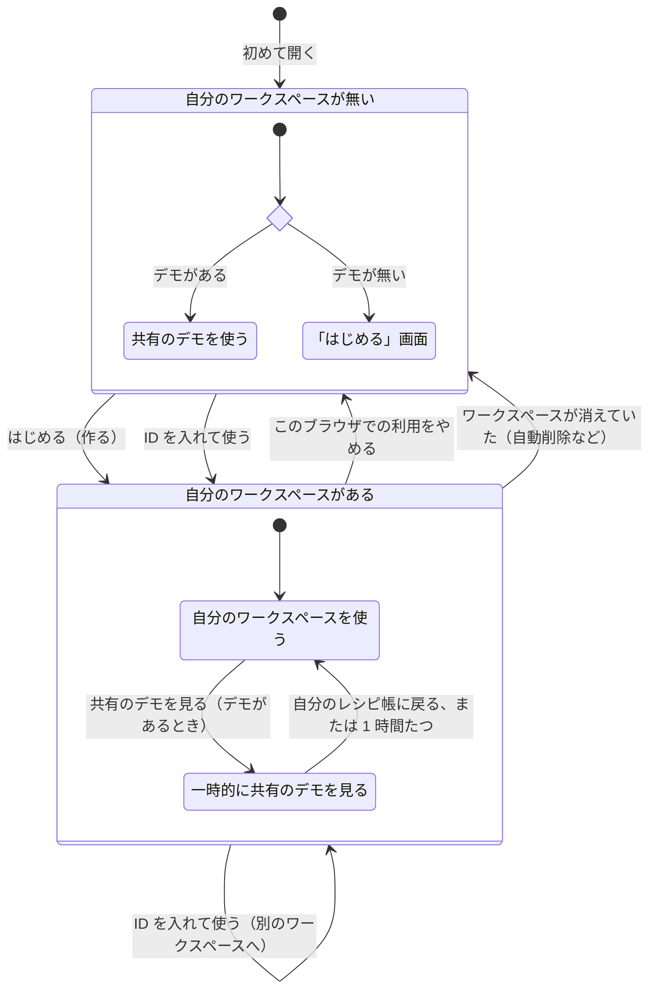

# recipe-box

料理のレシピを登録・検索できる、小さな Web アプリケーション。

[shoji9x9/skills](https://github.com/shoji9x9/skills) の `replace-strategy` とその姉妹スキル（`golden-dataset`・`parity-suite`・`parity-replace`・`parity-diff` など）を試すための題材として作る。
最初に Rust で作り（リライト前）、後でスキルを使って TypeScript に書き換える（リライト後）。

## 方針

- リライト前は Rust で書き、Cloudflare の Workers・D1・R2 で動かす。
- リライト後は TypeScript・React・Hono・Drizzle などで書き、Cloudflare 以外のプラットフォームで動かす想定とする。オブジェクトストレージは使わない。
  リライトの題材として差が出るよう、リライト前の技術スタックはリライト後となるべく異なるものにする。
- 画面のほかに API を持たせる。リライトの前後で同じ API を保ち、テストに使う。
- SQL は標準の範囲で書く。D1 は SQLite なので、SQLite だけで通じる書き方を避け、PostgreSQL に移しても差が出ないようにする。
- ログイン機能は作らない。利用者の情報を持たずに、ワークスペースの ID でデータを分ける。

## 仕様

### 画面

- レシピの一覧（料理名で検索できる）
- レシピの詳細
- レシピの登録と編集のフォーム
- レシピの削除
- ワークスペースの ID の表示と切り替え

| パス | 画面・操作 |
| --- | --- |
| `GET /?q=<文字列>&page=<番号>` | レシピの一覧。検索とページは API と同じ決まり。ワークスペースが無ければ「はじめる」画面 |
| `GET /recipes/new`・`POST /recipes` | 登録のフォームと、登録 |
| `GET /recipes/:id` | 詳細 |
| `GET /recipes/:id/edit`・`POST /recipes/:id` | 編集のフォームと、更新 |
| `POST /recipes/:id/delete` | 削除（一覧から消したときは、同じ検索とページに戻る） |
| `GET /workspace` | ワークスペースの ID の表示と切り替え |
| `POST /workspace` | ワークスペースを作る（「はじめる」） |
| `POST /workspace/switch` | 入力した ID のワークスペースに切り替える |
| `POST /workspace/forget` | このブラウザの Cookie を消す（ワークスペースそのものは消さない） |
| `POST /workspace/demo` | 自分のワークスペースを残したまま、1 時間だけ共有のデモを見る |
| `POST /workspace/own` | 共有のデモから、自分のワークスペースに戻る |

- 画面は、どのワークスペースを使うかを次の順に決める。
  1. Cookie の ID のワークスペースがあり、一時的にデモを見ていなければ、それを使う。
  2. 無ければ、共有のデモ（「デモ用のデータ」）を使う。デモは誰でも読み書きでき、どの画面にもその旨を出す。デモの ID は画面に出さない。
  3. デモも無ければ、「はじめる」画面を出す。
  Cookie の ID のワークスペースが無くなっていれば（自動削除など）、どの画面でも Cookie を消す。
- どのワークスペースを使うかの移り変わりは、次の状態遷移図のとおりである（「ワークスペースの状態」）。
- 自分のワークスペースを持つ人は、「共有のデモを見る」で一時的にデモに切り替えられる。切り替えの印は 1 時間で切れる Cookie に置き、自分の ID の Cookie は残す。
  デモを見ていることを忘れて、自分のレシピを共有のデモに書かないよう、1 時間で自分のレシピ帳に戻し、デモを見ている間はどの画面にも「自分のレシピ帳に戻る」を出す。
- ワークスペースは、「はじめる」ボタン（POST）を押したときだけ作る。GET では作らない。検索エンジンの巡回やリンクのプレビューで、アプリ全体の 1 日の上限を使い切らせないためである。
- 一覧の検索の条件が正しくない（料理名が 100 文字を超える、ページの番号が範囲の外）ときは、API と同じく `400` にし、誤りを一覧の場所に出す。
  入力しながらの検索は一覧の部分だけを入れ替えるので、エラーの画面にすると一覧が黙って空になるためである。
- 入力の検証はサーバーだけで行い、決まりとメッセージを API と 1 か所にまとめる。ブラウザの標準の検証（`required`・`maxlength` など）は使わない（`novalidate`）。
  ブラウザの検証では、表せない決まり（空白だけの料理名、文字をコードポイントで数えるなど）があり、`maxlength` は UTF-16 の単位で数えるのでサーバーとずれ、メッセージの文と見た目もブラウザごとに違うためである。
- 入力の誤りは、すべてを一度に、フォームの上の一覧（各欄へのリンク）と、各欄のすぐ下に出す（`400`）。入力した値は保つ。API は最初の 1 つだけを返す。
- 確かめる時は、最初は送信したときだけにする（react-hook-form の `mode: onSubmit` にあたる）。送信して誤りが出た後は、欄から離れたときにも、その欄を確かめ直す（`reValidateMode: onBlur` にあたる）。
  欄から離れたときは、フォーム全体を `POST /recipes/check`（確かめるだけで保存しない。ワークスペースも読まない）に送り、離れた欄と誤りの一覧だけを入れ替える。フォーカスは動かさない。
  ブラウザは textarea の改行を CRLF で送るので、LF にそろえてから確かめる。
- ページ全体へのメッセージは、見出しの下に、自動では消えない形で出す。操作が済んだこと（「保存しました」など）は緑で、移動先の画面に一度だけ出す（短い寿命の Cookie で種類のコードだけを渡す）。
  上限などの誤り（レシピの数の上限 `409` など）は赤で出す。自動で消えるトーストは、読む前に消えたり読み上げを聞き逃したりするので使わない。
- 登録・更新・削除などの POST は、成功したら `303` で移る。再読み込みで二重に送られないようにするためである。
- 画面の POST も、API と同じ書き込みの回数の制限と本文の大きさの上限を受ける。
  ただし確かめるだけの `POST /recipes/check` は、書き込みの回数の制限を使わない（送り元と本文の大きさだけを確かめる）。欄から離れるたびに呼ぶので、使うと直している途中で保存が `429` になり、保存も D1 の読み取りもしないので守るものが無いためである。
- 別のサイトから送られたフォームは、`Origin` が自分のホストと違えば `403` で断る（Cookie の SameSite=Lax に重ねた対策）。
- htmx で、検索は入力しながら一覧だけを入れ替え、そのほかのリンクとフォームはページ全体を入れ替える（`hx-boost`）。JavaScript が動かなくても、普通のリンクとフォームとして使える。
- 削除は、確認のダイアログ（`<dialog>`）で確かめる。JavaScript は使わず、HTML の Invoker Commands（`commandfor`・`command`）で開閉する。
  ブラウザ標準の `confirm()` はタイトル（「<ホスト> の内容」）を変えられないので使わない。Invoker Commands に対応していない古いブラウザでは、削除のボタンが反応しない。
- 画面の応答には、CSP（スクリプトとスタイルは自分のドメインのファイルだけ、インラインは禁止）・`X-Content-Type-Options: nosniff`・`Referrer-Policy: same-origin`・`Cache-Control: no-store` を付ける。
  htmx は、CSP に合わせて eval とインラインのスタイルを使わない設定にし、閲覧の履歴をブラウザに保存させない。
- CSS・htmx・アイコンは、Workers の静的アセット（`apps/recipe-box-rs/public/`）として配る。Worker を起動しないので、Worker のリクエストの数に入らない。
  htmx は pnpm で版を固定して入れ（`package.json`）、ビルドのときに `public/assets/` にコピーする。外部の CDN からは読まない。

#### ワークスペースの状態

画面を見ている人が、どのワークスペースを使うかの移り変わり。状態は Cookie で決まる（下の表）。



| Cookie | 中身 | 期間 | 付ける・消すとき |
| --- | --- | --- | --- |
| `__Host-workspace` | 自分のワークスペースの ID | 400 日 | 作る・ID を入れて使うときに付ける。利用をやめるとき、ワークスペースが消えていたとき（どの画面でも）に消す |
| `__Host-demo-view` | 一時的にデモを見ている印 | 1 時間 | 共有のデモを見るときに付ける。戻るとき、作る・ID を入れて使う・利用をやめるとき、ワークスペースが消えていたときに消す |
| `__Host-flash` | 次の画面に一度だけ出すメッセージの種類 | 60 秒 | 操作が済んだときに付け、次の画面を出すときに消す |

- 「はじめる」と「ID を入れて使う」は、失敗したら（回数や全体の上限、無い ID）状態を変えず、理由を出す。
- 一時的にデモを見ている間にデモが無くなったら（secret を外したなど）、自分のワークスペースを使う。
- デモの ID は、どの状態でも画面に出さない。自分の ID は、デモを見ている間も「ワークスペース」の画面に出す。

### テーブル

| テーブル | 内容 |
| --- | --- |
| `workspaces` | ワークスペース。最終利用日時と、自動削除の対象から外す印を持つ |
| `recipes` | レシピ。`workspace_id`、`name`（料理名・必須）、`search_name`（検索用。料理名の ASCII の英字だけを小文字にしたもので、アプリが作る）、`servings`（何人分・1〜100 の整数）、`ingredients`（材料・複数行）、`steps`（手順・複数行）、作った日時と最後に変えた日時 |
| 写真 | レシピの写真。`workspace_id`・`recipe_id`・形式・大きさ・保管先のキーなど（列は実装のときに決める） |

### API

| メソッドとパス | 内容 |
| --- | --- |
| `POST /api/workspaces` | ワークスペースを作り、ID を返す |
| `GET /api/recipes` | レシピの一覧 |
| `POST /api/recipes` | レシピの登録 |
| `GET /api/recipes/:id` | レシピの取得 |
| `PUT /api/recipes/:id` | レシピの更新 |
| `DELETE /api/recipes/:id` | レシピの削除（写真も消す） |
| `POST /api/recipes/:id/photos` | 写真を 1 枚追加する |

写真の一覧・取得・削除のパスは、実装のときに決める。

失敗したときは、状態コードと次の形の本文を返す。`error` は機械向けのコード、`message` は人向けの説明である。
入力の項目が正しくないときだけ、どの項目かを `field` で示す。

```json
{"error": "invalid_field", "message": "料理名を入力してください", "field": "name"}
```

| 状態コード | `error` | いつ |
| --- | --- | --- |
| `400` | `workspace_id_missing` | `X-Workspace-Id` ヘッダーが無い |
| `400` | `workspace_id_invalid` | `X-Workspace-Id` の形が正しくないか、2 つ以上ある |
| `400` | `invalid_body` | 本文が JSON として読めない、項目の型が違う（`servings` が文字列など）、`Content-Type: application/json` が無い。JSON として正しくても、64 ビットの浮動小数点数で表せない大きさの数（`1e400` など）と、対になっていないサロゲートのエスケープ（`"\ud800"` など）も、読めないものとして扱う |
| `400` | `invalid_field` | 項目の値が正しくない（下の「レシピの項目」） |
| `404` | `workspace_not_found` | そのワークスペースが無い |
| `404` | `recipe_not_found` | そのワークスペースに、その ID のレシピが無い（ID の形が正しくないときと、ほかのワークスペースのレシピを含む） |
| `404` | `not_found` | `/api` で始まるが、定義されていないパス |
| `405` | `method_not_allowed` | パスが受け付けないメソッド |
| `409` | `recipe_limit_reached` | ワークスペースのレシピが上限（40 件）に達していて、登録できない |
| `413` | `payload_too_large` | 本文が 128 KiB（131,072 バイト）を超える。`Content-Length` で超えると分かれば、本文を読まずに断る |
| `429` | `too_many_requests` | ワークスペースを作る回数か、書き込む API の回数の制限を超えた |
| `500` | `internal_error` | サーバーの中の失敗（詳しいことはログにだけ出す） |
| `503` | `capacity_reached` | アプリ全体のワークスペースの数か、1 日に作る数が上限に達していて、新しく作れない |

#### レシピの API

レシピの API は、どれも `X-Workspace-Id` で指定したワークスペースのレシピだけを扱う。

レシピは次の形の JSON で返す。日時は UNIX 時間のミリ秒である。

```json
{
  "id": "0123456789abcdef0123456789abcdef",
  "name": "カレー",
  "servings": 4,
  "ingredients": "玉ねぎ 2 個\nにんじん 1 本",
  "steps": "切る\n煮る",
  "created_at": 1794635048685,
  "updated_at": 1794635048685
}
```

| メソッドとパス | 成功したとき |
| --- | --- |
| `GET /api/recipes?q=<文字列>&page=<番号>` | `200` と `{"recipes": [<レシピ>, ...], "total": <総数>, "page": <番号>, "per_page": 20}`。作った日時の新しい順（同じ日時なら ID の大きい順）に 1 ページ分を返す |
| `POST /api/recipes` | `201` と登録したレシピ。`Location` ヘッダーに `/api/recipes/<ID>` |
| `GET /api/recipes/:id` | `200` とレシピ |
| `PUT /api/recipes/:id` | `200` と変えた後のレシピ。中身をすべて置き換える（省いた `ingredients`・`steps` は空になる） |
| `DELETE /api/recipes/:id` | `204`（本文なし） |

失敗の理由が 2 つ以上あるときは、次の順に確かめ、最初に見つかったものを返す。
書き込む API（`POST`・`PUT`・`DELETE`）の回数（`too_many_requests`）→ `Content-Length` による本文の大きさ（`payload_too_large`）→ ワークスペース（`X-Workspace-Id`）→ パスの ID の形（`recipe_not_found`）→ 本文の読み取り（`invalid_body`・`payload_too_large`）→ 項目の値（`invalid_field`）→ レシピが在るか（`recipe_not_found`）・レシピの数の上限（`recipe_limit_reached`）。
書き込みの回数と `Content-Length` を先に確かめるのは、ワークスペースを調べる D1 の読み取りを、連打や大きすぎる本文で増やさせないためである。

レシピの項目（`POST` と `PUT` の本文）は次のとおり。長さは Unicode のコードポイントの数で数える。知らない項目は無視する。

| 項目 | 決まり |
| --- | --- |
| `name` | 必須。空白（Unicode の White_Space の文字）だけにはできない。100 文字まで |
| `servings` | 必須。値が 1 から 100 までの整数の数値。書き方ではなく値で決める（`2.0` や `1e2` は受け付け、`2.5` や桁の大きな数は `invalid_field`） |
| `ingredients` | 省略できる（省くか `null` なら空）。2,000 文字まで。改行で区切った複数行 |
| `steps` | 省略できる（省くか `null` なら空）。5,000 文字まで。改行で区切った複数行 |

検索（`q`）は、料理名にその文字列を含むレシピを返す。ASCII の大文字と小文字は区別しない（ASCII 以外の大文字と小文字は区別する）。
`%`・`_`・`\` も文字そのものとして探す。URL のクエリの決まりどおり、`+` は空白として読む（`+` そのものを探すときは `%2B`）。空なら絞り込まない。100 文字まで。`q` が 2 つ以上あると `400`（`invalid_field`）を返す。
一覧は 1 ページ 20 件に分ける。`page` はページの番号で、省くと 1 ページ目。数字だけで書いた 1 から 2 までの整数を受け付け（レシピの数の上限 40 件が 2 ページに収まるため）（`02` は 2 ページ目）、それ以外か `page` が 2 つ以上あると `400`（`invalid_field`）を返す。
最後のページより後ろの番号では、空の `recipes` と総数を返す。`total` は条件に当てはまるレシピの総数で、画面はこれと `per_page` からページの数を出す。
`q` と `page` の両方が正しくなければ、`q` のエラーを返す。
ページ分けは `LIMIT` と `OFFSET` で行い、索引（`workspace_id`・`created_at`・`id`）の順に読む。`total` を数えるため、一覧を読むたびに、条件に当てはまるレシピをすべて数える。

検索には `LIKE` ではなく `instr`（SQLite の関数）を使う。D1 は `LIKE` のパターンを 50 バイトまでに制限していて、日本語の検索の文字列が 16 文字ほどで通らないためである（AGENTS.md の SQL の例外）。
大文字と小文字は、DB の `LOWER` を使わずにそろえる（`LOWER` は SQLite と PostgreSQL で ASCII 以外の扱いが違うため）。料理名の ASCII の英字だけを小文字にした列（`search_name`）をアプリで作って保存し、検索の文字列にも同じ変換をしてから比べる。

### ワークスペースによるデータの分離

- `POST /api/workspaces` が、推測できない 128 ビットの乱数の ID を発行し、`201` と `{"id": "<ID>"}` を返す。ID は 16 進数の小文字 32 文字。
- 発行の回数は、1 つの IP アドレス（IPv6 は上位 64 ビットの範囲）から 60 秒に 10 回までにする。超えたら `429`（`too_many_requests`）を返す。
  Cloudflare の Rate Limiting は拠点ごとにおおよそで数えるので、厳密な上限ではない（複数の拠点を通れば、拠点の数だけ増えうる）。
- アプリ全体のワークスペースは 200 個まで、作るのは UTC の 1 日に 20 個までにする。超えたら `503`（`capacity_reached`）を返す。
  D1 の行を数えて厳密に判定し、数えることと保存することを 1 つの SQL で行う（「費用の対策」）。
- API は `X-Workspace-Id` ヘッダーで、画面は Cookie（HttpOnly・Secure・SameSite=Lax）で ID を受け取る。
  ヘッダーが無ければ `400`（`workspace_id_missing`）、形が正しくないか 2 つ以上あれば `400`（`workspace_id_invalid`）、そのワークスペースが無ければ `404`（`workspace_not_found`）を返す。
- ワークスペースを使うと、最終利用日時を更新する。ただし、読むだけの API でも DB に書き込むことになるので、前の更新から 1 時間以上たっているときだけ更新する。
- すべてのクエリを `workspace_id` で絞り込む。ID を知っている人だけが、そのワークスペースのデータを読み書きできる。
- 最後に使われてから 14 日たったワークスペースは、定期実行（Cron Trigger）で消す。

### 写真

- 1 つのレシピに複数の写真を付けられる。
- 上限は 1 枚 4,000,000 バイト以下、1 レシピ 5 枚まで。形式は JPEG・PNG・WebP。
- 大きさが上限を超えたら 413、6 枚目を追加しようとしたら 409 を返す。
- リライト前は写真を R2 に、リライト後は DB に保管する。保管先が変わっても、API の仕様は変えない。

### デモ用のデータ

- 自動削除の対象から外した、デモ用のワークスペースを 1 つ持つ。自動削除から外す印は、管理用のコマンドでだけ付けられる。
- seed（`mise run seed`）が、デモ用のワークスペースのレシピを全部消してから、サンプルのレシピと写真を入れ直す。投入先はローカルと本番から選べる。
- seed は公開 API だけを呼ぶので、リライト後も同じ seed を使える。
- サンプルは `seed/recipes.json` と `seed/photos/` に置く。写真は自作かパブリックドメインのものだけを使う。
- デモ用のワークスペースの ID は公開しない。Worker の secret の `DEMO_WORKSPACE_ID` と、GitHub の Secrets などに置く。
  設定されていて、そのワークスペースがあれば、Cookie の無い人の画面にデモを出す（「画面」）。
- デモは誰でも読み書きできる共有のものなので、毎日決まった時刻に seed でリセットする（Issue #8）。デモでは写真を追加させない（Issue #6）。

## 技術構成（リライト前）

| 用途 | 使うもの |
| --- | --- |
| 言語 | Rust |
| Web フレームワーク | [axum](https://github.com/tokio-rs/axum)（[workers-rs](https://github.com/cloudflare/workers-rs) の `http` 機能で Workers 上で動かす） |
| 画面 | [askama](https://github.com/askama-rs/askama)（HTML テンプレート）と [htmx](https://htmx.org/) |
| 実行環境 | Cloudflare Workers |
| DB | Cloudflare D1 |
| 写真の保管先 | Cloudflare R2 |
| デプロイと開発用のサーバー | wrangler |
| リンターとフォーマッター | clippy・rustfmt・taplo（TOML）・rumdl（Markdown） |
| ツールの版の管理 | [mise](https://mise.jdx.dev/) |
| Node のパッケージマネージャー | pnpm |
| git フック | lefthook |

Cloudflare の新しい CLI の `cf` は 2026-09-28 に open beta になった。ただし公式ブログによると、Rust の Worker の開発とデプロイは wrangler に任せている。そのため wrangler を使い、リライト後に改めて検討する。

## セキュリティ

- コミットと CI で、gitleaks が秘密情報の混入を調べる。GitHub の secret scanning と push protection も有効にしている。
- 依存の更新と脆弱性の通知は Dependabot が担う。Rust の依存は cargo-deny でも調べる。
- workflow は、job ごとに最小の権限だけを与え、actionlint・ghalint・zizmor・CodeQL で調べる。
- 脆弱性の報告の仕方は [SECURITY.md](SECURITY.md) にある。

### 費用の対策

ログインの無い公開アプリなので、誰でも API を呼べる。自動化した攻撃で、ワークスペースと IP アドレスを使い分けながらデータを作られても、費用が決まった上限を超えないようにする。

上限は 3 つの層で設ける。下の層ほど、攻撃者が回避できない。

| 層 | 上限 | 超えたとき | 回避の手段 |
| --- | --- | --- | --- |
| IP アドレスごと（Rate Limiting、おおよそ） | ワークスペースを作る: 60 秒に 10 回。書き込む API（レシピの登録・更新・削除）: 60 秒に 30 回 | `429` | IP アドレスを変える |
| ワークスペースごと | レシピ: 40 件。本文: 128 KiB。料理名 100・材料 2,000・手順 5,000 文字 | `409`・`413`・`400` | ワークスペースを作り直す |
| **アプリ全体**（D1 で数えて厳密に判定） | ワークスペース: 200 個。作る数: UTC の 1 日に 20 個 | `503` | **回避できない** |

- レシピは 1 件で最大およそ 29 KB（7,200 文字をすべて 4 バイトの文字で書いた場合）なので、D1 に入るレシピは最大でも 200 × 40 × 29 KB ≒ 230 MB で、1 つの D1 の上限（無料のプランで 500 MB）の半分に収まる。
- アプリ全体の上限に達すると、攻撃者だけでなく全員が新しくワークスペースを作れなくなる。費用が際限なく増えるより良いとし、受け入れる。使われなくなったワークスペースは 14 日で自動で消える（Issue #7）ので、そのあとはまた作れる。
- 写真（R2）の上限は、R2 を使い始めるときに入れる（Issue #6・#15）。上限の無い状態で、R2 への書き込みを本番に出さない。

サービスごとに、使いすぎたときの動きと、量を抑える仕組みは次のとおり（料金と無料の範囲は 2026-11 時点の公式の文書による）。

| サービス | 使いすぎたとき | 量を抑える仕組み |
| --- | --- | --- |
| Workers | 無料のプランでは 1 日 10 万リクエストを超えると止まる（Error 1027）。有料のプランでは課金される | IP アドレスごとの回数の制限 |
| D1 | 無料のプランでは、読み書きの量と保存量の上限で止まる。有料のプランでは課金される | アプリ全体のワークスペースの数・ワークスペースごとのレシピの数・項目の長さ・ページ分け・最終利用日時の書き換えを 1 時間に 1 回に |
| R2（写真。まだ使っていない） | 無料の範囲（保存 10 GB-月、書き込みの操作 100 万回/月など）を超えると**課金される** | アプリ全体の写真の合計の大きさと、1 日の追加の回数の上限を、R2 に書き込む前に D1 で判定する（#6 で入れる） |

入れなかったもの:

- Cloudflare Turnstile（ボットの判定）: アプリ全体の上限で費用は守れる。画面と seed（API）の両方からの作成との両立が要り、外部のスクリプトを画面に読み込むことにもなる。
- `wrangler.toml` の `[limits]`（1 リクエストあたりの CPU 時間）: 無料のプランでは 1 回 10 ms に決まっている。
- WAF のレート制限のルール: WAF は自分のドメイン（ゾーン）に付ける設定で、`workers.dev` の URL には使わない前提にしている。

利用者の作業（ダッシュボードで行う）:

- 課金されうるサービスを使う前に、予算の通知（Budget alerts）を設定する。Manage Account > Billing > Billable Usage で Create budget alert を選び、金額を決める。
  通知は前日までの利用で 1 日 1 回判定されるので、すぐには届かない。通知は利用を止めない。
- 有料のプランでは、Workers の利用額の上限（spending limits）を設定できるかも確かめる。R2 には、利用を止める上限の設定が無い。

### サプライチェーン攻撃の対策

- 公開から 7 日たっていない版は使わない。悪意のある版の多くは、公開から数日のうちに見つかって取り下げられるためである。
  - Dependabot: `cooldown` で 7 日待つ。脆弱性を直す security update は待たずに届く。
  - mise: `minimum_release_age = "7d"`
  - pnpm: `minimumReleaseAge: 10080`（単位は分）
  - Cargo: `registry.global-min-publish-age = "7 days"`（Rust 1.100 から。Rust を 1.100 に上げるときに設定する）
- 依存はすべて lockfile で固定する（`Cargo.lock`・`pnpm-lock.yaml`・`mise.lock`）。CI は lockfile と食い違うと失敗する。
  mise が `cargo install` で入れる worker-build は、配布元の `Cargo.lock` に従って `--locked` でビルドされる。ただし `cargo install` は Cargo の待ち日数の設定を使わないので、worker-build の版は公開から 7 日たったものを手で選ぶ。
- GitHub Actions は workflow lockfile（`.github/workflows/actions.lock`）で、使う action とその action が使う action を commit に固定する。
- pnpm は、許可したパッケージのインストール時のスクリプトだけを実行する。

## 開発の始め方

### 前提

- [mise](https://mise.jdx.dev/)
- [GitHub CLI](https://cli.github.com/)（`gh auth login` で認証しておく）
- Google Chrome（エージェントが chrome-devtools MCP で画面を確かめるときだけ要る）
- `curl` と `jq`（`mise run smoke` のスモークテストで使う）
- OS のパッケージの `pkg-config` と OpenSSL の開発用ファイル。worker-build のビルドに要る。
  Ubuntu では `sudo apt-get install -y pkg-config libssl-dev` で入る。

### 準備

```bash
mise install    # mise.lock のとおりに Rust・Node・pnpm・各種の検査ツールを入れる
pnpm install    # wrangler・commitlint・chrome-devtools-mcp を入れ、lefthook の git フックを有効にする
```

### よく使うコマンド

| コマンド | 内容 |
| --- | --- |
| `mise run dev` | ローカルの D1 にマイグレーションを当て、Worker を起動する（<http://localhost:8787>） |
| `mise run migrate` | ローカルの D1 にマイグレーションを当てる |
| `mise run smoke` | 起動中のローカルの Worker に API を呼び、実際の D1 を通して確かめる（先に別の端末で `mise run dev`）。ワークスペースを作る回数の制限の確認は、`CHECK_RATE_LIMIT=1` を付けたときだけ行う |
| `mise run test` | Rust のテストを実行する |
| `mise run build` | Worker をビルドする |
| `mise run fmt` | Rust・TOML・Markdown を整形する |
| `mise run lint` | 整形の確認と静的解析（clippy・taplo・rumdl・actionlint・ghalint・zizmor・shellcheck） |
| `mise run audit` | 依存の脆弱性・ライセンス・取得元・署名を調べる（cargo-deny・pnpm audit signatures） |

commit のときは、lefthook が整形・静的解析・gitleaks・commitlint を実行する。

### ディレクトリ

| パス | 内容 |
| --- | --- |
| `apps/recipe-box-rs/` | リライト前の Rust の Worker |
| `apps/recipe-box-rs/migrations/` | D1 のマイグレーション（テーブルを作る・変える SQL） |
| `scripts/smoke-test.sh` | ローカルの Worker に API を呼んで確かめるスクリプト（CI でも使う） |
| `.github/workflows/` | CI・デプロイ・レビューなどの workflow と、その lockfile（`actions.lock`） |

## CI と CD

| workflow | 内容 |
| --- | --- |
| `ci.yml` | PR ごとに、静的解析・依存の検査・テスト・ビルドと動作確認・秘密情報の検査を行う |
| `pr-title.yml` | PR のタイトルが Conventional Commits の形かを調べる（タイトルを直したときにも動く） |
| `codeql.yml` | Rust のコードと workflow を CodeQL で解析する |
| `claude-review.yml` | PR を Claude Code でレビューする |
| `deploy.yml` | main に入った変更を Cloudflare Workers へデプロイする。先に D1 にマイグレーションを当てる |
| `dependabot-automerge.yml` | Dependabot の PR のうち、1.0 以上の依存の minor と patch の更新を自動でマージする |
| `outdated.yml` | mise のツールに新しい版があれば、追跡用の Issue を作る |

main は、ブランチルールで PR を通さない変更と強制 push を禁止し、CI の成功を必須にしている。

D1 のデータベース（`recipe-box`）は、無ければ `deploy.yml` が作る。`wrangler.toml` にはアカウントごとの `database_id` を書かず、wrangler に名前で探させる。

本番は `<名前>.workers.dev` で公開する（`wrangler.toml` の `workers_dev = true`）。版ごとのプレビューの URL は、誰でも開ける URL を増やさないよう作らない（`preview_urls = false`）。

### デプロイとレビューの準備

GitHub の Settings → Environments に、次の値を置く。

| Environment | 種類 | 名前 | 値 |
| --- | --- | --- | --- |
| `production` | secret | `CLOUDFLARE_API_TOKEN` | Cloudflare のダッシュボードの「Account API tokens」で作る。権限は「Edit Cloudflare Workers」と「D1 Edit」にし、対象はデプロイするアカウントだけに絞る |
| `production` | secret | `CLOUDFLARE_ACCOUNT_ID` | Cloudflare のアカウント ID。認証情報ではないが、公開リポジトリの Actions のログに出さないよう secret にする |
| `claude-review` | secret | `CLAUDE_CODE_OAUTH_TOKEN` | `claude setup-token` で作る |

値が無い間、`deploy.yml` は何もせずに終わり、`claude-review.yml` は失敗する。

## ライセンス

[MIT License](LICENSE)
