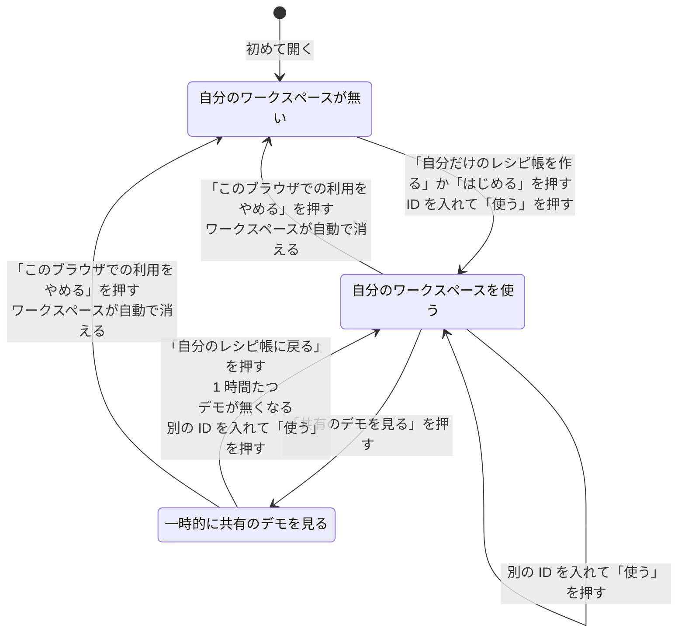

# 仕様

recipe-box の画面・API・データの決まり。リライトの前後で同じに保つ。

## 用語

| 用語 | 意味 |
| --- | --- |
| ワークスペース | レシピを入れる帳面の単位。ログインの代わりに、推測できない ID（16 進数 32 文字）で持ち主を分ける。ID を知っている人だけが、そのワークスペースのレシピを読み書きできる。14 日使わないと自動で消える |
| 自分のワークスペース | 画面の「はじめる」で作るか、ID を入れて使い始めた、その人のワークスペース。ブラウザの Cookie に ID を覚える |
| デモ（共有のデモ） | 誰でも見て編集できる、共有のワークスペース。サンプルのレシピが入っていて、毎日入れ直す（リセットする）。初めて開いた人には、これを見せる。ID は公開しない |

## 画面

- レシピの一覧（料理名で検索できる）
- レシピの詳細
- レシピの登録と編集のフォーム
- レシピの削除
- ワークスペースの ID の表示と切り替え

| パス | 画面・操作 |
| --- | --- |
| `GET /?q=<文字列>&page=<番号>` | レシピの一覧。検索とページは API と同じ決まり。ワークスペースが無ければ「はじめる」画面 |
| `GET /recipes/new`・`POST /recipes` | 登録のフォームと、登録 |
| `GET /recipes/:id` | 詳細 |
| `GET /recipes/:id/edit`・`POST /recipes/:id` | 編集のフォームと、更新 |
| `POST /recipes/:id/delete` | 削除（一覧から消したときは、同じ検索とページに戻る） |
| `GET /workspace` | ワークスペースの ID の表示と切り替え |
| `POST /workspace` | ワークスペースを作る（「はじめる」） |
| `POST /workspace/switch` | 入力した ID のワークスペースに切り替える |
| `POST /workspace/forget` | このブラウザの Cookie を消す（ワークスペースそのものは消さない） |
| `POST /workspace/demo` | 自分のワークスペースを残したまま、1 時間だけ共有のデモを見る |
| `POST /workspace/own` | 共有のデモから、自分のワークスペースに戻る |

- 画面は、どのワークスペースを使うかを次の順に決める。
  1. Cookie の ID のワークスペースがあり、一時的にデモを見ていなければ、それを使う。
  2. 無ければ、共有のデモ（「デモ用のデータ」）を使う。デモは誰でも読み書きでき、どの画面にもその旨を出す。デモの ID は画面に出さない。
  3. デモも無ければ、「はじめる」画面を出す。
  Cookie の ID のワークスペースが無くなっていれば（自動削除など）、どの画面でも Cookie を消す。
- どのワークスペースを使うかの移り変わりは、次の状態遷移図のとおりである（「ワークスペースの状態」）。
- 自分のワークスペースを持つ人は、「共有のデモを見る」で一時的にデモに切り替えられる。切り替えの印は 1 時間で切れる Cookie に置き、自分の ID の Cookie は残す。
  デモを見ていることを忘れて、自分のレシピを共有のデモに書かないよう、1 時間で自分のレシピ帳に戻し、デモを見ている間はどの画面にも「自分のレシピ帳に戻る」を出す。
- ワークスペースは、「はじめる」ボタン（POST）を押したときだけ作る。GET では作らない。検索エンジンの巡回やリンクのプレビューで、アプリ全体の 1 日の上限を使い切らせないためである。
- 一覧の検索の条件が正しくない（料理名が 100 文字を超える、ページの番号が範囲の外）ときは、API と同じく `400` にし、誤りを一覧の場所に出す。
  入力しながらの検索は一覧の部分だけを入れ替えるので、エラーの画面にすると一覧が黙って空になるためである。
- 入力の検証はサーバーだけで行い、決まりとメッセージを API と 1 か所にまとめる。ブラウザの標準の検証（`required`・`maxlength` など）は使わない（`novalidate`）。
  ブラウザの検証では、表せない決まり（空白だけの料理名、文字をコードポイントで数えるなど）があり、`maxlength` は UTF-16 の単位で数えるのでサーバーとずれ、メッセージの文と見た目もブラウザごとに違うためである。
- 入力の誤りは、すべてを一度に、フォームの上の一覧（各欄へのリンク）と、各欄のすぐ下に出す（`400`）。入力した値は保つ。API は最初の 1 つだけを返す。
- 確かめる時は、最初は送信したときだけにする（react-hook-form の `mode: onSubmit` にあたる）。送信して誤りが出た後は、欄から離れたときにも、その欄を確かめ直す（`reValidateMode: onBlur` にあたる）。
  欄から離れたときは、フォーム全体を `POST /recipes/check`（確かめるだけで保存しない。ワークスペースも読まない）に送り、離れた欄と誤りの一覧だけを入れ替える。フォーカスは動かさない。
  ブラウザは textarea の改行を CRLF で送るので、LF にそろえてから確かめる。
- ページ全体へのメッセージは、見出しの下に、自動では消えない形で出す。操作が済んだこと（「保存しました」など）は緑で、移動先の画面に一度だけ出す（短い寿命の Cookie で種類のコードだけを渡す）。
  上限などの誤り（レシピの数の上限 `409` など）は赤で出す。自動で消えるトーストは、読む前に消えたり読み上げを聞き逃したりするので使わない。
- 登録・更新・削除などの POST は、成功したら `303` で移る。再読み込みで二重に送られないようにするためである。
- 画面の POST も、API と同じ書き込みの回数の制限と本文の大きさの上限を受ける。
  ただし確かめるだけの `POST /recipes/check` は、書き込みの回数の制限を使わない（送り元と本文の大きさだけを確かめる）。欄から離れるたびに呼ぶので、使うと直している途中で保存が `429` になり、保存も D1 の読み取りもしないので守るものが無いためである。
- 別のサイトから送られたフォームは、`Origin` が自分のホストと違えば `403` で断る（Cookie の SameSite=Lax に重ねた対策）。
- htmx で、検索は入力しながら一覧だけを入れ替え、そのほかのリンクとフォームはページ全体を入れ替える（`hx-boost`）。JavaScript が動かなくても、普通のリンクとフォームとして使える。
- 削除は、確認のダイアログ（`<dialog>`）で確かめる。JavaScript は使わず、HTML の Invoker Commands（`commandfor`・`command`）で開閉する。
  ブラウザ標準の `confirm()` はタイトル（「<ホスト> の内容」）を変えられないので使わない。Invoker Commands に対応していない古いブラウザでは、削除のボタンが反応しない。
- 画面の応答には、CSP（スクリプトとスタイルは自分のドメインのファイルだけ、インラインは禁止）・`X-Content-Type-Options: nosniff`・`Referrer-Policy: same-origin`・`Cache-Control: no-store` を付ける。
  htmx は、CSP に合わせて eval とインラインのスタイルを使わない設定にし、閲覧の履歴をブラウザに保存させない。
- CSS・htmx・アイコンは、Workers の静的アセット（`apps/recipe-box-rs/public/`）として配る。Worker を起動しないので、Worker のリクエストの数に入らない。
  htmx は pnpm で版を固定して入れ（`package.json`）、ビルドのときに `public/assets/` にコピーする。外部の CDN からは読まない。

### ワークスペースの状態

画面を見ている人が、どのワークスペースを使っているかの移り変わり。状態は 3 つで、矢印は利用者の操作か、時間などの出来事である（1 つの矢印に、同じ移り変わりを起こす操作や出来事を、1 行ずつ並べる）。
状態は Cookie と、デモがあるかで決まる（下の表）。



| 状態 | 画面に出すもの |
| --- | --- |
| 自分のワークスペースが無い | デモがあれば共有のデモ（「自分だけのレシピ帳を作る」の帯付き）。デモが無ければ「はじめる」画面 |
| 自分のワークスペースを使う | 自分のレシピ。「ワークスペース」の画面に、デモがあれば「共有のデモを見る」を出す |
| 一時的に共有のデモを見る | 共有のデモ（「自分のレシピ帳に戻る」の帯付き） |

| Cookie | 中身 | 期間 | 付ける・消すとき |
| --- | --- | --- | --- |
| `__Host-workspace` | 自分のワークスペースの ID | 400 日 | 作る・ID を入れて使うときに付ける。利用をやめるとき、ワークスペースが消えていたとき（どの画面でも）に消す |
| `__Host-demo-view` | 一時的にデモを見ている印 | 1 時間 | 共有のデモを見るときに付ける。戻るとき、作る・ID を入れて使う・利用をやめるとき、ワークスペースが消えていたときに消す |
| `__Host-flash` | 次の画面に一度だけ出すメッセージの種類 | 60 秒 | 操作が済んだときに付け、次の画面を出すときに消す |

- 「はじめる」と「ID を入れて使う」は、失敗したら（回数や全体の上限、無い ID）状態を変えず、理由を出す。
- 「自分のワークスペースが無い」状態で、デモを見せるか「はじめる」画面を出すかは、デモがあるかで決まる。利用者の操作で移る状態ではないので、図では分けない。
  作るボタンは、デモを見せているときは「自分だけのレシピ帳を作る」、「はじめる」画面では「はじめる」である。
- 「共有のデモを見る」のボタンは、デモがあるときだけ出す。デモが無い環境では、「一時的に共有のデモを見る」には移れない。
- 「デモが無くなる」は、運営の側で secret の `DEMO_WORKSPACE_ID` を外すなどして、デモが使えなくなることである。印の Cookie が残っていても、自分のワークスペースを使う。
- デモの ID は、どの状態でも画面に出さない。自分の ID は、デモを見ている間も「ワークスペース」の画面に出す。

## テーブル

| テーブル | 内容 |
| --- | --- |
| `workspaces` | ワークスペース。最終利用日時と、自動削除の対象から外す印を持つ |
| `recipes` | レシピ。`workspace_id`、`name`（料理名・必須）、`search_name`（検索用。料理名の ASCII の英字だけを小文字にしたもので、アプリが作る）、`servings`（何人分・1〜100 の整数）、`ingredients`（材料・複数行）、`steps`（手順・複数行）、作った日時と最後に変えた日時 |
| 写真 | レシピの写真。`workspace_id`・`recipe_id`・形式・大きさ・保管先のキーなど（列は実装のときに決める） |

## API

| メソッドとパス | 内容 |
| --- | --- |
| `POST /api/workspaces` | ワークスペースを作り、ID を返す |
| `GET /api/recipes` | レシピの一覧 |
| `POST /api/recipes` | レシピの登録 |
| `GET /api/recipes/:id` | レシピの取得 |
| `PUT /api/recipes/:id` | レシピの更新 |
| `DELETE /api/recipes/:id` | レシピの削除（写真も消す） |
| `POST /api/recipes/:id/photos` | 写真を 1 枚追加する |

写真の一覧・取得・削除のパスは、実装のときに決める。

失敗したときは、状態コードと次の形の本文を返す。`error` は機械向けのコード、`message` は人向けの説明である。
入力の項目が正しくないときだけ、どの項目かを `field` で示す。

```json
{"error": "invalid_field", "message": "料理名を入力してください", "field": "name"}
```

| 状態コード | `error` | いつ |
| --- | --- | --- |
| `400` | `workspace_id_missing` | `X-Workspace-Id` ヘッダーが無い |
| `400` | `workspace_id_invalid` | `X-Workspace-Id` の形が正しくないか、2 つ以上ある |
| `400` | `invalid_body` | 本文が JSON として読めない、項目の型が違う（`servings` が文字列など）、`Content-Type: application/json` が無い。JSON として正しくても、64 ビットの浮動小数点数で表せない大きさの数（`1e400` など）と、対になっていないサロゲートのエスケープ（`"\ud800"` など）も、読めないものとして扱う |
| `400` | `invalid_field` | 項目の値が正しくない（下の「レシピの項目」） |
| `404` | `workspace_not_found` | そのワークスペースが無い |
| `404` | `recipe_not_found` | そのワークスペースに、その ID のレシピが無い（ID の形が正しくないときと、ほかのワークスペースのレシピを含む） |
| `404` | `not_found` | `/api` で始まるが、定義されていないパス |
| `405` | `method_not_allowed` | パスが受け付けないメソッド |
| `409` | `recipe_limit_reached` | ワークスペースのレシピが上限（40 件）に達していて、登録できない |
| `413` | `payload_too_large` | 本文が 128 KiB（131,072 バイト）を超える。`Content-Length` で超えると分かれば、本文を読まずに断る |
| `429` | `too_many_requests` | ワークスペースを作る回数か、書き込む API の回数の制限を超えた |
| `500` | `internal_error` | サーバーの中の失敗（詳しいことはログにだけ出す） |
| `503` | `capacity_reached` | アプリ全体のワークスペースの数か、1 日に作る数が上限に達していて、新しく作れない |

### レシピの API

レシピの API は、どれも `X-Workspace-Id` で指定したワークスペースのレシピだけを扱う。

レシピは次の形の JSON で返す。日時は UNIX 時間のミリ秒である。

```json
{
  "id": "0123456789abcdef0123456789abcdef",
  "name": "カレー",
  "servings": 4,
  "ingredients": "玉ねぎ 2 個\nにんじん 1 本",
  "steps": "切る\n煮る",
  "created_at": 1794635048685,
  "updated_at": 1794635048685
}
```

| メソッドとパス | 成功したとき |
| --- | --- |
| `GET /api/recipes?q=<文字列>&page=<番号>` | `200` と `{"recipes": [<レシピ>, ...], "total": <総数>, "page": <番号>, "per_page": 20}`。作った日時の新しい順（同じ日時なら ID の大きい順）に 1 ページ分を返す |
| `POST /api/recipes` | `201` と登録したレシピ。`Location` ヘッダーに `/api/recipes/<ID>` |
| `GET /api/recipes/:id` | `200` とレシピ |
| `PUT /api/recipes/:id` | `200` と変えた後のレシピ。中身をすべて置き換える（省いた `ingredients`・`steps` は空になる） |
| `DELETE /api/recipes/:id` | `204`（本文なし） |

失敗の理由が 2 つ以上あるときは、次の順に確かめ、最初に見つかったものを返す。
書き込む API（`POST`・`PUT`・`DELETE`）の回数（`too_many_requests`）→ `Content-Length` による本文の大きさ（`payload_too_large`）→ ワークスペース（`X-Workspace-Id`）→ パスの ID の形（`recipe_not_found`）→ 本文の読み取り（`invalid_body`・`payload_too_large`）→ 項目の値（`invalid_field`）→ レシピが在るか（`recipe_not_found`）・レシピの数の上限（`recipe_limit_reached`）。
書き込みの回数と `Content-Length` を先に確かめるのは、ワークスペースを調べる D1 の読み取りを、連打や大きすぎる本文で増やさせないためである。

レシピの項目（`POST` と `PUT` の本文）は次のとおり。長さは Unicode のコードポイントの数で数える。知らない項目は無視する。

| 項目 | 決まり |
| --- | --- |
| `name` | 必須。空白（Unicode の White_Space の文字）だけにはできない。100 文字まで |
| `servings` | 必須。値が 1 から 100 までの整数の数値。書き方ではなく値で決める（`2.0` や `1e2` は受け付け、`2.5` や桁の大きな数は `invalid_field`） |
| `ingredients` | 省略できる（省くか `null` なら空）。2,000 文字まで。改行で区切った複数行 |
| `steps` | 省略できる（省くか `null` なら空）。5,000 文字まで。改行で区切った複数行 |

検索（`q`）は、料理名にその文字列を含むレシピを返す。ASCII の大文字と小文字は区別しない（ASCII 以外の大文字と小文字は区別する）。
`%`・`_`・`\` も文字そのものとして探す。URL のクエリの決まりどおり、`+` は空白として読む（`+` そのものを探すときは `%2B`）。空なら絞り込まない。100 文字まで。`q` が 2 つ以上あると `400`（`invalid_field`）を返す。
一覧は 1 ページ 20 件に分ける。`page` はページの番号で、省くと 1 ページ目。数字だけで書いた 1 から 2 までの整数を受け付け（レシピの数の上限 40 件が 2 ページに収まるため）（`02` は 2 ページ目）、それ以外か `page` が 2 つ以上あると `400`（`invalid_field`）を返す。
最後のページより後ろの番号では、空の `recipes` と総数を返す。`total` は条件に当てはまるレシピの総数で、画面はこれと `per_page` からページの数を出す。
`q` と `page` の両方が正しくなければ、`q` のエラーを返す。
ページ分けは `LIMIT` と `OFFSET` で行い、索引（`workspace_id`・`created_at`・`id`）の順に読む。`total` を数えるため、一覧を読むたびに、条件に当てはまるレシピをすべて数える。

検索には `LIKE` ではなく `instr`（SQLite の関数）を使う。D1 は `LIKE` のパターンを 50 バイトまでに制限していて、日本語の検索の文字列が 16 文字ほどで通らないためである（AGENTS.md の SQL の例外）。
大文字と小文字は、DB の `LOWER` を使わずにそろえる（`LOWER` は SQLite と PostgreSQL で ASCII 以外の扱いが違うため）。料理名の ASCII の英字だけを小文字にした列（`search_name`）をアプリで作って保存し、検索の文字列にも同じ変換をしてから比べる。

## ワークスペースによるデータの分離

- `POST /api/workspaces` が、推測できない 128 ビットの乱数の ID を発行し、`201` と `{"id": "<ID>"}` を返す。ID は 16 進数の小文字 32 文字。
- 発行の回数は、1 つの IP アドレス（IPv6 は上位 64 ビットの範囲）から 60 秒に 10 回までにする。超えたら `429`（`too_many_requests`）を返す。
  Cloudflare の Rate Limiting は拠点ごとにおおよそで数えるので、厳密な上限ではない（複数の拠点を通れば、拠点の数だけ増えうる）。
- アプリ全体のワークスペースは 200 個まで、作るのは UTC の 1 日に 20 個までにする。超えたら `503`（`capacity_reached`）を返す。
  D1 の行を数えて厳密に判定し、数えることと保存することを 1 つの SQL で行う（[セキュリティ](security.md)の「費用の対策」）。
- API は `X-Workspace-Id` ヘッダーで、画面は Cookie（HttpOnly・Secure・SameSite=Lax）で ID を受け取る。
  ヘッダーが無ければ `400`（`workspace_id_missing`）、形が正しくないか 2 つ以上あれば `400`（`workspace_id_invalid`）、そのワークスペースが無ければ `404`（`workspace_not_found`）を返す。
- ワークスペースを使うと、最終利用日時を更新する。ただし、読むだけの API でも DB に書き込むことになるので、前の更新から 1 時間以上たっているときだけ更新する。
- すべてのクエリを `workspace_id` で絞り込む。ID を知っている人だけが、そのワークスペースのデータを読み書きできる。
- 最後に使われてから 14 日たったワークスペースは、定期実行（Cron Trigger）で消す。

## 写真

- 1 つのレシピに複数の写真を付けられる。
- 上限は 1 枚 4,000,000 バイト以下、1 レシピ 5 枚まで。形式は JPEG・PNG・WebP。
- 大きさが上限を超えたら 413、6 枚目を追加しようとしたら 409 を返す。
- リライト前は写真を R2 に、リライト後は DB に保管する。保管先が変わっても、API の仕様は変えない。

## デモ用のデータ

- 自動削除の対象から外した、デモ用のワークスペースを 1 つ持つ。自動削除から外す印は、管理用のコマンドでだけ付けられる。
- seed（`mise run seed`）が、デモ用のワークスペースのレシピを全部消してから、サンプルのレシピと写真を入れ直す。投入先はローカルと本番から選べる。
- seed は公開 API だけを呼ぶので、リライト後も同じ seed を使える。
- サンプルは `seed/recipes.json` と `seed/photos/` に置く。写真は自作かパブリックドメインのものだけを使う。
- デモ用のワークスペースの ID は公開しない。Worker の secret の `DEMO_WORKSPACE_ID` と、GitHub の Secrets などに置く。
  設定されていて、そのワークスペースがあれば、Cookie の無い人の画面にデモを出す（「画面」）。
- デモは誰でも読み書きできる共有のものなので、毎日決まった時刻に seed でリセットする（Issue #8）。デモでは写真を追加させない（Issue #6）。
