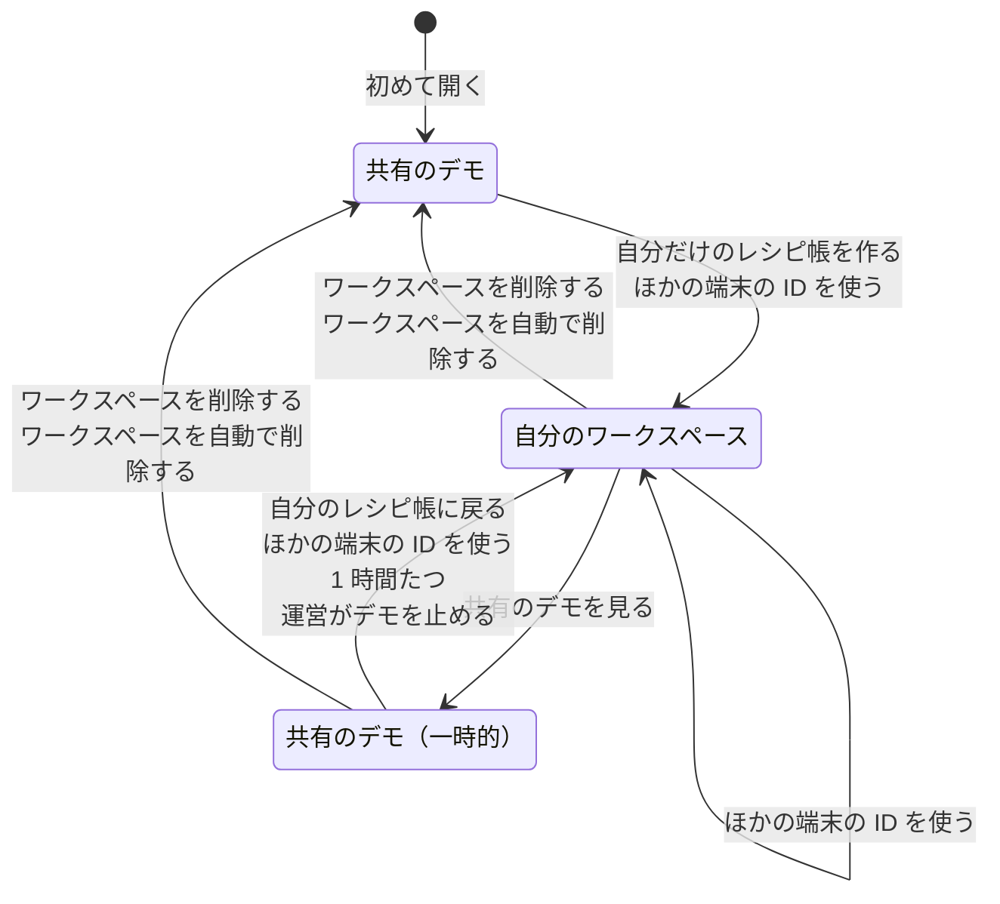

# 仕様

recipe-box の画面・API・データの決まり。リライトの前後で同じに保つ。

## 用語

| 用語 | 意味 |
| --- | --- |
| ワークスペース | レシピを入れる帳面の単位。ログインの代わりに、推測できない ID（16 進数 32 文字）で持ち主を分ける。ID を知っている人だけが、そのワークスペースのレシピを読み書きできる。14 日使わないと自動で消える |
| 自分のワークスペース | 画面の「はじめる」で作るか、ID を入れて使い始めた、その人のワークスペース。ブラウザの Cookie に ID を覚える |
| デモ（共有のデモ） | 誰でも見て編集できる、共有のワークスペース。サンプルのレシピが入っていて、毎日入れ直す（リセットする）。初めて開いた人には、これを見せる。ID は公開しない |

## 画面

- レシピの一覧（料理名で検索できる）
- レシピの詳細
- レシピの登録と編集のフォーム
- レシピの削除
- 写真の追加・削除（レシピの編集の画面で行う）と表示（一覧・詳細・編集の画面）
- ワークスペースの ID の表示と切り替え、ワークスペースの削除

| パス | 画面・操作 |
| --- | --- |
| `GET /?q=<文字列>&page=<番号>` | レシピの一覧。検索とページは API と同じ決まり。ワークスペースが無ければ「はじめる」画面 |
| `GET /recipes/new`・`POST /recipes` | 登録のフォームと、登録 |
| `GET /recipes/:id` | 詳細 |
| `GET /recipes/:id/edit`・`POST /recipes/:id` | 編集のフォームと、更新 |
| `POST /recipes/:id/delete` | 削除（一覧から消したときは、同じ検索とページに戻る） |
| `POST /recipes/:id/photos` | 写真を追加する（multipart/form-data の `photo` の欄か、写真のバイト列そのもの）。フォームのときは編集の画面に戻る |
| `GET /recipes/:id/photos/:photo_id` | 写真のデータ（一覧・詳細・編集の画面の `` が読む） |
| `POST /recipes/:id/photos/:photo_id/delete` | 写真を削除し、編集の画面に戻る |
| `GET /workspace` | ワークスペースの ID の表示と切り替え |
| `POST /workspace` | ワークスペースを作る（「はじめる」） |
| `POST /workspace/switch` | 入力した ID のワークスペースに切り替える |
| `POST /workspace/delete` | 自分のワークスペースを、レシピと写真ごと削除する。このブラウザの Cookie も消す |
| `POST /workspace/demo` | 自分のワークスペースを残したまま、1 時間だけ共有のデモを見る |
| `POST /workspace/own` | 共有のデモから、自分のワークスペースに戻る |
| `GET /about/` | このアプリの作りの解説（静的なページ。`/about` は `/about/` に移す）。どの画面にも、ページの下にリンクを出す |

- 画面は、どのワークスペースを使うかを次の順に決める。
  1. Cookie の ID のワークスペースがあり、一時的にデモを見ていなければ、それを使う。
  2. 無ければ、共有のデモ（「デモ用のデータ」）を使う。デモは誰でも読み書きでき、どの画面にもその旨を出す。デモの ID は画面に出さない。
  3. デモも無ければ、「はじめる」画面を出す。
  Cookie の ID のワークスペースが無くなっていれば（自動削除など）、どの画面でも Cookie を消す。ただし、同じ応答でワークスペースを作った・切り替えたときは、新しい Cookie を残す。
- どのワークスペースを使うかの移り変わりは、次の状態遷移図のとおりである（「ワークスペースの状態」）。
- 自分のワークスペースを持つ人は、「共有のデモを見る」で一時的にデモに切り替えられる。切り替えの印は 1 時間で切れる Cookie に置き、自分の ID の Cookie は残す。
  デモを見ていることを忘れて、自分のレシピを共有のデモに書かないよう、1 時間で自分のレシピ帳に戻し、デモを見ている間はどの画面にも「自分のレシピ帳に戻る」を出す。
- 「ワークスペース」の画面の「ワークスペースを削除する」で、自分のワークスペースを、レシピと写真ごと削除できる。一時的にデモを見ている間も、消すのは自分のワークスペース（画面に出している ID のもの）である。
  消したワークスペースは、ほかの端末からも使えなくなる。消した後は、共有のデモ（デモが無ければ「はじめる」画面）に戻る。共有のデモは削除できない。
  削除のフォームは画面に出した ID を送り、Cookie の ID と違えば（画面を開いた後に別のタブで切り替えたなど）、消さずに `409` で理由を出す。元に戻せないので、見ていなかったワークスペースを消さないためである。
- ワークスペースは、「はじめる」ボタン（POST）を押したときだけ作る。GET では作らない。検索エンジンの巡回やリンクのプレビューで、アプリ全体の 1 日の上限を使い切らせないためである。
- 一覧の検索の条件が正しくない（料理名が 100 文字を超える、ページの番号が範囲の外）ときは、API と同じく `400` にし、誤りを一覧の場所に出す。
  入力しながらの検索は一覧の部分だけを入れ替えるので、エラーの画面にすると一覧が黙って空になるためである。
- 入力の検証はサーバーだけで行い、決まりとメッセージを API と 1 か所にまとめる。ブラウザの標準の検証（`required`・`maxlength` など）は使わない（`novalidate`）。
  ブラウザの検証では、表せない決まり（空白だけの料理名、文字をコードポイントで数えるなど）があり、`maxlength` は UTF-16 の単位で数えるのでサーバーとずれ、メッセージの文と見た目もブラウザごとに違うためである。
- 送信したときの入力の誤りは、すべてを一度に、フォームの上の一覧（各欄へのリンク）と、各欄のすぐ下に出す（`400`）。入力した値は保つ。API は最初の 1 つだけを返す。
- 確かめる時は、最初は送信したときだけにする（react-hook-form の `mode: onSubmit` にあたる）。送信して誤りが出た後は、欄から離れたときにも、その欄を確かめ直す（`reValidateMode: onBlur` にあたる）。
  欄から離れたときは、フォーム全体を `POST /recipes/check`（確かめるだけで保存しない。ワークスペースも読まない）に送り、離れた欄（入力と、そのすぐ下の誤り）だけを入れ替える。フォーカスは動かさない。
  ブラウザは textarea の改行を CRLF で送るので、LF にそろえてから確かめる。
- フォームの上の誤りの一覧は、送信したときだけ作り、欄から離れたときには入れ替えない。一覧は最後に送信したときの誤りを示し、その後に直した誤りも、欄から離れて新しく出た誤りも、次に送信するまで一覧には反映しない（各欄のすぐ下の誤りは、離れたときに反映する）。
  一覧のリンクを押すと、押した時点で欄から離れる。そのときに一覧を入れ替えると、ボタンを離す前に押しているリンクが入れ替わり、ブラウザがクリックとみなさない（押した要素と離した要素が違うため）。キーボードで一覧のリンクにいるときも、フォーカスが外れる。
- ページの中を移るとき（誤りの一覧のリンクなど）は、滑らかにスクロールする（OS で動きを減らす設定にしている人には動かさない）。CSS でページ全体に指定するので、フォーカスやアドレスの `#` で動くスクロールも滑らかになる。
  移った先が上に固定したヘッダーに隠れないよう、上を空けて止める。
- ページ全体へのメッセージは、見出しの下に、自動では消えない形で出す。操作が済んだこと（「保存しました」など）は緑で、移動先の画面に一度だけ出す（短い寿命の Cookie で種類のコードだけを渡す）。
  上限などの誤り（レシピの数の上限 `409` など）は赤で出す。自動で消えるトーストは、読む前に消えたり読み上げを聞き逃したりするので使わない。
- 登録・更新・削除などの POST は、成功したら `303` で移る。再読み込みで二重に送られないようにするためである。
- 画面の POST も、API と同じ書き込みの回数の制限と本文の大きさの上限を受ける。
  ただし確かめるだけの `POST /recipes/check` は、書き込みの回数の制限を使わない（送り元と本文の大きさだけを確かめる）。欄から離れるたびに呼ぶので、使うと直している途中で保存が `429` になり、保存も D1 の読み取りもしないので守るものが無いためである。
- 別のサイトから送られたフォームは、`Origin` が自分のホストと違えば `403` で断る（Cookie の SameSite=Lax に重ねた対策）。
- htmx で、検索は入力しながら一覧だけを入れ替え、そのほかのリンクとフォームはページ全体を入れ替える（`hx-boost`）。JavaScript が動かなくても、普通のリンクとフォームとして使える。
  日本語の入力（IME）の変換中は検索せず、確定してから検索する（`public/assets/search.js`）。変換中でも、入力欄の値の全体が ASCII だけのとき（Android のキーボードが英字を変換中として打つときなど）は、打ちながら検索する。値の一部が日本語なら、確定まで待つ。確定する前の文字（「おにg」など）で一覧を入れ替えたり、ブラウザの履歴を増やしたりしないためである。
  検索の欄の文字を消す × は、Tab で選べるボタンにする（ブラウザが出す × は Tab で選べないので隠す）。文字があるときだけ出し、押すと欄を空にして絞り込まない一覧にし、欄にフォーカスを戻す。JavaScript が動かなければ、絞り込まない一覧の画面に移る。
- 一覧では、写真のあるレシピに、先頭の写真（追加した順の最初）を小さく出す。写真の無いレシピには、同じ大きさの「写真なし」の枠を出す。
  読み込み中の写真（無地の枠）と見分けられるようにし、料理名の位置を、写真の有無に関わらずそろえるためである。
  写真は縮小していない原寸（1 枚 4 MB まで）なので、見える所に来てから読み（`loading="lazy"`）、大きさを決めておいて、読み込んだときに並びがずれないようにする。
  ただし写真のある最初のカードの写真は、最初の表示で一番大きな要素（LCP）になりやすいので、遅らせずに高い優先度（`fetchpriority="high"`）で読む。
  料理名はすぐ下のリンクにあるので、写真の代替テキストは空にし、「写真なし」も読み上げない。API の一覧（`GET /api/recipes`）は、先頭の写真を返さない。
- 一覧のカードは、写真などカードのどこを押しても、詳細の画面に移る。リンクは料理名の 1 つだけにし、押せる範囲を CSS でカードの全体に広げる（読み上げとキーボードで、同じリンクを 2 回たどらないため）。削除のボタンは、広げた範囲より上に置く。
- 写真は、詳細の画面と編集の画面で、追加した順に並べる。詳細の画面は写真を見せるだけにし、追加と削除は編集の画面で行う（共有のデモでは、どちらの画面でも追加・削除できないことを書く）。
  詳細の画面では、最初の写真を遅らせずに高い優先度で読み、ほかの写真は見える所に来てから読む（狭い画面では 1 列に並び、下に続くため）。
  登録の画面では、レシピの ID がまだ無く写真を付けられないので、保存した後に編集の画面で追加できることを書く。
- どの画面にも、同じページの説明（`<meta name="description">`）を付ける。レシピの中身は書かない（ワークスペースの中身は、その ID を知る人だけが見るため）。
- 編集の画面の写真の欄は、料理名などのフォームの外に置く。写真は、追加・削除したときにすぐ保存する（料理名などの「保存する」とは別の操作）。
  写真を料理名などと同じフォームに入れると、入力の誤りで画面を出し直すたびに写真を選び直すことになり（ブラウザはファイルの欄を出し直せない）、本文も数 MB になるためである。
  写真の欄には、追加・削除するとすぐ保存されることと、書きかけの料理名などがあるときは先に保存することを書く。
- 写真の追加は普通のフォーム（`multipart/form-data`）で送り、削除は確認のダイアログのフォームで送る。JavaScript が動かなくても使え、どちらも編集の画面に戻る（書きかけの料理名などは消える）。
  同じ追加のパスは、写真のバイト列そのもの（API と同じ形。multipart にしない）も受け付ける。画面の JavaScript から 1 枚ずつ、本文を読みためずに送れるようにするためである（下の「写真」）。
- JavaScript が動くときは、追加と削除の後に、ページを読み直さず、写真の欄と見出しの下の知らせだけを入れ替える（`public/assets/photo-upload.js`）。料理名などのフォームは入れ替えないので、書きかけの入力は消えない。
  入れ替えで、押したボタン（削除のダイアログなど）が消えたときは、写真の欄の見出しにフォーカスを移す。
  - 削除は、確認のダイアログのフォームを JavaScript が送り、サーバーが移らせた編集の画面から、写真の欄と知らせ（「写真を削除しました」など）を写す。
    失敗してエラーの画面が返ったときは、知らせだけを写し、写真の欄はそのまま使えるようにする。通信できなかったときは、その旨を知らせる。
    削除が済んで編集の画面に移らされたのに、その画面を読めなかったときは、消した写真を欄から除き、済んだことを知らせる。
    ワークスペースが無いなどで、編集の画面でない所へ移らされたときは、編集の画面をページごと読み直す（サーバーが移らせる先に、アドレスもそろう）。
  - 追加のフォームでは、複数の写真を一度に選べる。選んだ写真は、フォームの代わりに、1 枚ずつ写真のバイト列そのものとして同じパスに送る。1 回の本文は 1 枚の写真の大きさなので、本文の上限・写真の上限・書き込みの回数の制限（1 枚 1 回）は、フォームで送るときと同じである。
  - 写真のバイト列そのものを追加できたときは、`303` で編集の画面に移らせず、`204` を返す（知らせの Cookie も付けない）。JavaScript が、すべて送り終えてから写真の欄を 1 回だけ読み直すためである。失敗のときは、フォームと同じ編集の画面かエラーの画面を返す。
  - 1 枚の写真の上限を超える写真と、空のファイルは、送らずに、追加できなかった写真に数える。
  - 送る写真の枚数が、あと追加できる枚数より多いときは、1 枚も送らずに断り、フォームの下に知らせる。
  - 一部の写真が上限や形式の誤りで追加できなくても、追加できた写真は残す。
  - 送り終えたら写真の欄を読み直し、見出しの下に、追加できた枚数（緑）と、追加できなかった写真のファイル名と理由（赤）を出す。理由は、サーバーが編集の画面に出す知らせの文と同じである（送らずに断った空のファイルは「空のファイルは追加できません」）。
    1 枚も送らなかったとき（選んだ写真がすべて大きすぎるか空のとき）は、写真の欄は変わらないので読み直さず、今の画面に理由を出し、ファイルの欄を空にする。
    送っている間にほかの画面に移ったときは、読み直さない。読み直せないとき（通信の失敗など）は、今の画面のまま結果を出し、フォームを使える状態に戻す。
  - その写真だけの誤り（`400`・`413`・`415`）なら、残りの写真を続けて送る。それ以外の失敗（枚数や合計の上限・ワークスペースが無い・回数の制限・通信の失敗など）は、続けても追加できないので、残りの写真は送らずに、追加できなかった写真に数える。
    ワークスペースが無いなどで、サーバーがほかの画面に移らせたときは、編集の画面をページごと読み直す。
  - 送る写真の枚数が多すぎて断るときは、送らずに断る写真（大きすぎる・空）があれば、そのファイル名と理由も一緒に知らせる。
  - 写真を選ばずに「追加する」を押したときは、送らずに、フォームの下に「追加する写真を選んでください」と出す（htmx にページの本文ごと入れ替えさせず、書きかけの入力を残すため）。
  上限や形式の誤り（`413`・`415`・`409` など）は、編集の画面の見出しの下に赤で出す。JavaScript が動かずにファイルを選ばずに送ったときは `400`。
  写真のフォームの本文の上限は、1 枚の写真の上限（4,000,000 バイト）に multipart の区切りの分（64 KiB）を足したものにし、写真そのものの大きさは API と同じく確かめる。
  写真のバイト列そのものの本文の上限は、1 枚の写真の上限にする（区切りが無いため）。
  `Content-Length` が本文の上限を超えるとき（スマートフォンの写真でよく起きる）は、本文を読まずに `413` のエラーの画面にし、写真の上限と「編集の画面に戻る」を出す。
  `Content-Length` の無い本文（chunked）は、読む途中で上限に当たると、編集の画面に同じ説明を出す（`413`）。
  multipart として読めない本文は、編集の画面に「写真を読めませんでした」と出す（`400`）。
  レシピの写真が上限（5 枚）に達したら、追加のフォームを出さない。共有のデモでは、追加のフォームと削除のボタンを出さず、送られても `403` で断る。
  デモの ID は、「ほかの端末の ID」として入れても無い ID と同じに断る。Cookie を書き換えて使っても、自分のワークスペースとして扱わずにデモを出し、無い ID と同じく Cookie を消す（デモの ID だと分からないように）。
- 削除は、レシピも写真もワークスペースも、確認のダイアログ（`<dialog>`）で確かめる。JavaScript は使わず、HTML の Invoker Commands（`commandfor`・`command`）で開閉する。
  ブラウザ標準の `confirm()` はタイトル（「<ホスト> の内容」）を変えられないので使わない。Invoker Commands に対応していない古いブラウザでは、削除のボタンが反応しない。
  ダイアログは、開くボタンの文字・見出し・説明・送る先と、一緒に送る hidden の欄だけを変え、形はどれも同じにする。
  hidden の欄は、一覧から消したときの戻り先（検索の条件とページ）と、ワークスペースの削除の画面の ID（「ワークスペース」の項）である。
- 画面の応答には、CSP（スクリプトとスタイルは自分のドメインのファイルだけ、インラインは禁止）・`X-Content-Type-Options: nosniff`・`Referrer-Policy: same-origin`・`Cache-Control: no-store` を付ける。
  写真のデータの応答だけは、API と同じ `Cache-Control` と CSP にする（ハンドラーが付けたヘッダーを変えない）。
  htmx は、CSP に合わせて eval とインラインのスタイルを使わない設定にし、閲覧の履歴をブラウザに保存させない。
- CSS・htmx・写真の追加と削除の JavaScript・アイコンは、Workers の静的アセット（`apps/recipe-box-rs/public/`）として配る。Worker を起動しないので、Worker のリクエストの数に入らない。
  htmx は pnpm で版を固定して入れ（`package.json`）、ビルドのときに `public/assets/` にコピーする。外部の CDN からは読まない。
- 解説（`/about/`）も静的アセットで、`mise run guide` が作る（docs/development.md）。Worker が動かないので、CSP（スタイルと画像は自分のドメインのファイルだけ、スクリプトは使わない）・`X-Content-Type-Options: nosniff`・`Referrer-Policy: same-origin` は `apps/recipe-box-rs/public/_headers` で付ける。

### ワークスペースの状態

画面を見ている人が、どのワークスペースを使っているかの移り変わり。状態は 3 つある。
矢印のラベルは、利用者が押すボタンか、アプリや運営が起こす出来事である。1 本の矢印に、同じ移り変わりを起こすものを 1 行ずつ並べる。詳しくは図の下の表に書く。



| 状態 | 意味 | 画面に出すもの |
| --- | --- | --- |
| 共有のデモ | このブラウザに自分のワークスペースが無く、誰でも見て編集できるデモを使う[^no-demo] | デモのレシピと、「自分だけのレシピ帳を作る」の帯 |
| 自分のワークスペース | このブラウザが覚えた ID のワークスペースを使う。ほかの端末で作った ID を使っているときも同じ状態である | 自分のレシピ |
| 共有のデモ（一時的） | 自分のワークスペースを残したまま、デモを見る。「共有のデモ」と違い、自分のワークスペースに戻れる | デモのレシピと、「自分のレシピ帳に戻る」の帯 |

[^no-demo]: デモが無いとき（secret の `DEMO_WORKSPACE_ID` を設定していないか、その ID のワークスペースが無いとき）は、デモの代わりに「はじめる」画面を出す。「自分だけのレシピ帳を作る」のボタンの名前は「はじめる」になる。また「共有のデモを見る」のボタンを出さないので、「共有のデモ（一時的）」には移れない。

| 矢印のラベル | 詳しく | どこから |
| --- | --- | --- |
| 初めて開く | Cookie の無いブラウザで開く | — |
| 自分だけのレシピ帳を作る | ボタンを押すと、新しいワークスペースができる | デモの帯・「ワークスペース」の画面・「はじめる」画面 |
| ほかの端末の ID を使う | ほかの端末で作ったワークスペースの ID を入れて、「使う」を押す | 「ワークスペース」の画面・「はじめる」画面 |
| 共有のデモを見る | 「共有のデモを見る（1 時間）」を押す。デモがあるときだけ出す | 「ワークスペース」の画面 |
| 自分のレシピ帳に戻る | ボタンを押す | デモの帯・「ワークスペース」の画面 |
| 1 時間たつ | 「共有のデモを見る」を押してから 1 時間たつ | — |
| 運営がデモを止める | 運営の側で `DEMO_WORKSPACE_ID` を外すなどして、デモを使えなくする | — |
| ワークスペースを削除する | ボタンを押し、確認のダイアログで「削除する」を押す。ワークスペースを、レシピと写真ごと消す | 「ワークスペース」の画面 |
| ワークスペースを自動で削除する | 14 日使われていないワークスペースを、アプリが毎日 1 回、自動で削除する（下の「ワークスペースによるデータの分離」）。次に開いたときに、ブラウザの ID を消す | — |

- 「自分だけのレシピ帳を作る」と「ほかの端末の ID を使う」が失敗したとき（回数や全体の上限・無い ID）は、状態を変えず、理由を出す。
  理由を出す画面は、「自分だけのレシピ帳を作る」では「はじめる」画面、「ほかの端末の ID を使う」では「ワークスペース」の画面である。
- 「運営がデモを止める」の後も、一時的にデモを見ている印の Cookie は 1 時間まで残る。その間に運営がデモを戻すと、操作をしなくても「共有のデモ（一時的）」に戻る。運営の側の操作でしか起きないので、図には書かない。
- デモの ID は、どの状態でも画面に出さない。自分の ID は、「共有のデモ（一時的）」の間も「ワークスペース」の画面に出す。

状態は、次の Cookie と、デモがあるかで決まる。

| Cookie | 中身 | 期間 | 付ける・消すとき |
| --- | --- | --- | --- |
| `__Host-workspace` | 自分のワークスペースの ID | 400 日 | 「自分だけのレシピ帳を作る」「ほかの端末の ID を使う」で付ける。「ワークスペースを削除する」で消す。ワークスペースが無くなっていたとき（「ワークスペースを自動で削除する」のほか、DB を作り直したときなど）と、共有のデモの ID のときも、どの画面でも消す（同じ応答で作った・切り替えた新しい Cookie は残す） |
| `__Host-demo-view` | 一時的にデモを見ている印 | 1 時間 | 「共有のデモを見る」で付ける。「自分のレシピ帳に戻る」と、上の `__Host-workspace` を付ける・消すときに消す |
| `__Host-flash` | 次の画面に一度だけ出すメッセージの種類 | 60 秒 | 操作が済んだときに付け、次の画面を出すときに消す |

## テーブル

| テーブル | 内容 |
| --- | --- |
| `workspaces` | ワークスペース。最終利用日時と、自動削除の対象から外す印を持つ。消すと、レシピの行も消える（`ON DELETE CASCADE`） |
| `recipes` | レシピ。`workspace_id`、`name`（料理名・必須）、`search_name`（検索用。料理名の ASCII の英字だけを小文字にしたもので、アプリが作る）、`servings`（何人分・1〜100 の整数）、`ingredients`（材料・複数行）、`steps`（手順・複数行）、作った日時と最後に変えた日時 |
| `photos` | 写真の情報。`workspace_id`・`recipe_id`・`id`・`content_type`（形式）・`size`（バイト）・`created_at`・`pending`（R2 への書き込みか削除が終わっていない印。下の「写真」）。写真のデータは R2 のキー `photos/<workspace_id>/<recipe_id>/<id>` に置く。レシピを消すと行も消える（`ON DELETE CASCADE`） |
| `workspace_creations` | ワークスペースを作った記録（`created_at` だけ。ワークスペースの ID は持たない）。アプリ全体の 1 日に作る数を数える。ワークスペースを消しても残す |
| `photo_uploads` | 写真を追加した記録（`id`・`created_at`）。アプリ全体の 1 日の追加の回数を数える。写真を消しても残す |

## API

| メソッドとパス | 内容 |
| --- | --- |
| `POST /api/workspaces` | ワークスペースを作り、ID を返す |
| `DELETE /api/workspaces` | `X-Workspace-Id` のワークスペースを、レシピと写真ごと削除する |
| `GET /api/recipes` | レシピの一覧 |
| `POST /api/recipes` | レシピの登録 |
| `GET /api/recipes/:id` | レシピの取得 |
| `PUT /api/recipes/:id` | レシピの更新 |
| `DELETE /api/recipes/:id` | レシピの削除（写真も消す） |
| `GET /api/recipes/:id/photos` | レシピの写真の一覧 |
| `POST /api/recipes/:id/photos` | 写真を 1 枚追加する |
| `GET /api/recipes/:id/photos/:photo_id` | 写真のデータ |
| `DELETE /api/recipes/:id/photos/:photo_id` | 写真の削除 |

失敗したときは、状態コードと次の形の本文を返す。`error` は機械向けのコード、`message` は人向けの説明である。
入力の項目が正しくないときだけ、どの項目かを `field` で示す。

```json
{"error": "invalid_field", "message": "料理名を入力してください", "field": "name"}
```

| 状態コード | `error` | いつ |
| --- | --- | --- |
| `400` | `workspace_id_missing` | `X-Workspace-Id` ヘッダーが無い |
| `400` | `workspace_id_invalid` | `X-Workspace-Id` の形が正しくないか、2 つ以上ある |
| `400` | `invalid_body` | 本文が JSON として読めない、項目の型が違う（`servings` が文字列など）、`Content-Type: application/json` が無い。JSON として正しくても、64 ビットの浮動小数点数で表せない大きさの数（`1e400` など）と、対になっていないサロゲートのエスケープ（`"\ud800"` など）も、読めないものとして扱う |
| `400` | `invalid_field` | 項目の値が正しくない（下の「レシピの項目」） |
| `403` | `demo_photos_disabled` | 共有のデモのワークスペースに、写真を追加するか、写真を消そうとした |
| `403` | `demo_workspace_protected` | 共有のデモのワークスペースか、自動削除と削除から外す印（`pinned`）の付いたワークスペースを削除しようとした |
| `404` | `workspace_not_found` | そのワークスペースが無い |
| `404` | `recipe_not_found` | そのワークスペースに、その ID のレシピが無い（ID の形が正しくないときと、ほかのワークスペースのレシピを含む） |
| `404` | `photo_not_found` | そのレシピに、その ID の写真が無い（ID の形が正しくないときを含む） |
| `404` | `not_found` | `/api` で始まるが、定義されていないパス |
| `405` | `method_not_allowed` | パスが受け付けないメソッド |
| `409` | `recipe_limit_reached` | ワークスペースのレシピが上限（80 件）に達していて、登録できない |
| `409` | `photo_limit_reached` | レシピの写真が上限（5 枚）に達していて、追加できない |
| `409` | `photo_storage_limit_reached` | 追加すると、ワークスペースの写真の大きさの合計が上限（100,000,000 バイト）を超える |
| `413` | `payload_too_large` | 本文が 128 KiB（131,072 バイト）を超える。写真の API では、写真が 4,000,000 バイトを超える。`Content-Length` で超えると分かれば、本文を読まずに断る |
| `415` | `unsupported_photo_type` | 写真が JPEG・PNG・WebP のどれでもない（中身の先頭のバイトで決める） |
| `429` | `too_many_requests` | ワークスペースを作る回数か、書き込む API の回数の制限を超えた |
| `500` | `internal_error` | サーバーの中の失敗（詳しいことはログにだけ出す） |
| `503` | `capacity_reached` | アプリ全体の量が上限に達していて、新しく作れない。ワークスペースの数・1 日に作る数・写真の大きさの合計・1 日に写真を追加する回数（docs/security.md の「費用の対策」） |

### レシピの API

レシピの API は、どれも `X-Workspace-Id` で指定したワークスペースのレシピだけを扱う。

レシピは次の形の JSON で返す。日時は UNIX 時間のミリ秒である。

```json
{
  "id": "0123456789abcdef0123456789abcdef",
  "name": "カレー",
  "servings": 4,
  "ingredients": "玉ねぎ 2 個\nにんじん 1 本",
  "steps": "切る\n煮る",
  "created_at": 1794635048685,
  "updated_at": 1794635048685
}
```

| メソッドとパス | 成功したとき |
| --- | --- |
| `GET /api/recipes?q=<文字列>&page=<番号>` | `200` と `{"recipes": [<レシピ>, ...], "total": <総数>, "page": <番号>, "per_page": 20}`。作った日時の新しい順（同じ日時なら ID の大きい順）に 1 ページ分を返す |
| `POST /api/recipes` | `201` と登録したレシピ。`Location` ヘッダーに `/api/recipes/<ID>` |
| `GET /api/recipes/:id` | `200` とレシピ |
| `PUT /api/recipes/:id` | `200` と変えた後のレシピ。中身をすべて置き換える（省いた `ingredients`・`steps` は空になる） |
| `DELETE /api/recipes/:id` | `204`（本文なし） |

失敗の理由が 2 つ以上あるときは、次の順に確かめ、最初に見つかったものを返す。
書き込む API（`POST`・`PUT`・`DELETE`）の回数（`too_many_requests`）→ `Content-Length` による本文の大きさ（`payload_too_large`）→ ワークスペース（`X-Workspace-Id`）→ パスの ID の形（`recipe_not_found`）→ 本文の読み取り（`invalid_body`・`payload_too_large`）→ 項目の値（`invalid_field`）→ レシピが在るか（`recipe_not_found`）・レシピの数の上限（`recipe_limit_reached`）。
書き込みの回数と `Content-Length` を先に確かめるのは、ワークスペースを調べる D1 の読み取りを、連打や大きすぎる本文で増やさせないためである。

レシピの項目（`POST` と `PUT` の本文）は次のとおり。長さは Unicode のコードポイントの数で数える。知らない項目は無視する。

| 項目 | 決まり |
| --- | --- |
| `name` | 必須。空白（Unicode の White_Space の文字）だけにはできない。100 文字まで |
| `servings` | 必須。値が 1 から 100 までの整数の数値。書き方ではなく値で決める（`2.0` や `1e2` は受け付け、`2.5` や桁の大きな数は `invalid_field`） |
| `ingredients` | 省略できる（省くか `null` なら空）。2,000 文字まで。改行で区切った複数行 |
| `steps` | 省略できる（省くか `null` なら空）。5,000 文字まで。改行で区切った複数行 |

検索（`q`）は、料理名にその文字列を含むレシピを返す。ASCII の大文字と小文字は区別しない（ASCII 以外の大文字と小文字は区別する）。
`%`・`_`・`\` も文字そのものとして探す。URL のクエリの決まりどおり、`+` は空白として読む（`+` そのものを探すときは `%2B`）。空なら絞り込まない。100 文字まで。`q` が 2 つ以上あると `400`（`invalid_field`）を返す。
一覧は 1 ページ 20 件に分ける。`page` はページの番号で、省くと 1 ページ目。数字だけで書いた 1 から 4 までの整数を受け付け（レシピの数の上限 80 件が 4 ページに収まるため）（`02` は 2 ページ目）、それ以外か `page` が 2 つ以上あると `400`（`invalid_field`）を返す。
最後のページより後ろの番号では、空の `recipes` と総数を返す。`total` は条件に当てはまるレシピの総数で、画面はこれと `per_page` からページの数を出す。
`q` と `page` の両方が正しくなければ、`q` のエラーを返す。
ページ分けは `LIMIT` と `OFFSET` で行い、索引（`workspace_id`・`created_at`・`id`）の順に読む。
画面の一覧では、レシピごとの先頭の写真（追加した日時の古い順、同じ日時なら ID の小さい順の最初）を、同じクエリの副問い合わせ（`MIN`）で求める。写真の主キー（`workspace_id`・`recipe_id`・`id`）で、そのレシピの写真（5 枚まで）だけを読む。`total` を数えるため、一覧を読むたびに、条件に当てはまるレシピをすべて数える。

検索には `LIKE` ではなく `instr`（SQLite の関数）を使う。D1 は `LIKE` のパターンを 50 バイトまでに制限していて、日本語の検索の文字列が 16 文字ほどで通らないためである（AGENTS.md の SQL の例外）。
大文字と小文字は、DB の `LOWER` を使わずにそろえる（`LOWER` は SQLite と PostgreSQL で ASCII 以外の扱いが違うため）。料理名の ASCII の英字だけを小文字にした列（`search_name`）をアプリで作って保存し、検索の文字列にも同じ変換をしてから比べる。

### 写真の API

写真の API も、`X-Workspace-Id` で指定したワークスペースのレシピの写真だけを扱う。写真の情報は次の形の JSON で返す。

```json
{
  "id": "0123456789abcdef0123456789abcdef",
  "content_type": "image/jpeg",
  "size": 1048576,
  "created_at": 1794635048685
}
```

| メソッドとパス | 成功したとき |
| --- | --- |
| `GET /api/recipes/:id/photos` | `200` と `{"photos": [<写真の情報>, ...]}`。追加した順（同じ日時なら ID の順） |
| `POST /api/recipes/:id/photos` | `201` と追加した写真の情報。本文は写真のバイト列そのもの（multipart にしない） |
| `GET /api/recipes/:id/photos/:photo_id` | `200` と写真のバイト列。`Content-Type` は保存した形式 |
| `DELETE /api/recipes/:id/photos/:photo_id` | `204`（本文なし） |

- 形式は、本文の先頭のバイト（マジックナンバー）で決める。`Content-Type` ヘッダーは見ない。宣言と中身が違うファイルを、別の形式として配らないためである。
- 写真のデータを返すときは、`Cache-Control: private, max-age=86400`・`Vary: X-Workspace-Id, Cookie`・`X-Content-Type-Options: nosniff`・`Content-Security-Policy: default-src 'none'; frame-ancestors 'none'; sandbox` を付ける。
  写真の ID は使い回さず、中身も変わらないので、ブラウザに 1 日残させて R2 の読み取りを減らす。消した写真が残り続けないよう、それより長くはしない。
- 失敗の理由が 2 つ以上あるときは、次の順に確かめる。
  書き込みの回数（`too_many_requests`）→ `Content-Length`（`payload_too_large`）→ ワークスペース → パスの ID の形（`recipe_not_found`・`photo_not_found`）→ 本文の読み取り（`payload_too_large`）→ デモか（`demo_photos_disabled`）→ 大きさ（`payload_too_large`）→ 形式（`unsupported_photo_type`）→ レシピが在るか（`recipe_not_found`）→ レシピの枚数（`photo_limit_reached`）→ ワークスペースの合計（`photo_storage_limit_reached`）→ アプリ全体の上限（`capacity_reached`）。
  R2 に書いている間にレシピが消されたときは、R2 のデータを消して、`404`（`recipe_not_found`）を返す。
- レシピを消すと、その写真も消える。共有のデモでも同じである（デモのレシピは誰でも消せるので、その写真も消える。毎日のリセットで戻る）。

## ワークスペースによるデータの分離

- `POST /api/workspaces` が、推測できない 128 ビットの乱数の ID を発行し、`201` と `{"id": "<ID>"}` を返す。ID は 16 進数の小文字 32 文字。
- 発行の回数は、1 つの IP アドレス（IPv6 は上位 64 ビットの範囲）から 60 秒に 10 回までにする。超えたら `429`（`too_many_requests`）を返す。
  Cloudflare の Rate Limiting は拠点ごとにおおよそで数えるので、厳密な上限ではない（複数の拠点を通れば、拠点の数だけ増えうる）。
- アプリ全体のワークスペースは 100 個まで、作るのは UTC の 1 日に 20 個までにする。超えたら `503`（`capacity_reached`）を返す。
  D1 の行を数えて厳密に判定し、数えることと保存することを 1 つのトランザクションで行う（[セキュリティ](security.md)の「費用の対策」）。
  1 日に作った数は、ワークスペースを消しても残る作った記録で数える（作ると消すを繰り返して超えさせない）。
- API は `X-Workspace-Id` ヘッダーで、画面は Cookie（HttpOnly・Secure・SameSite=Lax）で ID を受け取る。
  ヘッダーが無ければ `400`（`workspace_id_missing`）、形が正しくないか 2 つ以上あれば `400`（`workspace_id_invalid`）、そのワークスペースが無ければ `404`（`workspace_not_found`）を返す。
- ワークスペースを使うと、最終利用日時を更新する。ただし、読むだけの API でも DB に書き込むことになるので、前の更新から 1 時間以上たっているときだけ更新する。
- すべてのクエリを `workspace_id` で絞り込む。ID を知っている人だけが、そのワークスペースのデータを読み書きできる。
- `DELETE /api/workspaces` は、`X-Workspace-Id` のワークスペースを、レシピと写真ごと消し、`204`（本文なし）を返す。
  書き込む API と同じ回数の制限を受ける。失敗の理由は、回数（`too_many_requests`）→ ワークスペース（`X-Workspace-Id`）→ デモか印があるか（`demo_workspace_protected`）の順に確かめる。
- 最後に使われてから 14 日たったワークスペースは、定期実行（Cron Trigger、毎日 UTC の 18 時）で、レシピと写真ごと消す。
  - 消す順は、`DELETE /api/workspaces` と同じである（下の「写真」）。
  - 対象を選んでから 1 つずつ消すので、選んだ後に使われたワークスペースがありうる。R2 の写真を消す直前に最終利用日時と印を読み直し、D1 で消すときにも同じ条件で確かめ直して、使われていれば消さない。
    読み直してから R2 を消すまでの、ごく短い間に使われたときだけは、R2 の写真のデータが消えていることがある。
  - 1 つのワークスペースで失敗しても、ほかは消す。1 回目の R2 の削除で失敗したワークスペースは D1 の行が残るので、次の日にもう一度消す。
    D1 で消した後の 2 回目の R2 の削除で失敗すると、その間に追加された写真のデータが R2 に残る（レシピの削除と同じ）。
  - ワークスペースの削除とは別に、1 日の数を数えるための記録（`photo_uploads`・`workspace_creations`）のうち、UTC の前の日までのものを消す。
  - また、R2 への書き込みか削除が終わっていない印（`pending`）が付いたまま 1 時間を過ぎた写真の行を、R2 のデータと一緒に消す（下の「写真」）。
    R2 のデータを先に消し、消せなければ行を残して、次の日にもう一度試す。
  - 形の正しくない ID の行（アプリは作らない）は消せないので、失敗に数えて知らせ、ほかのワークスペースは消す。
  - 失敗の理由はログに出す。ワークスペースの ID は持ち主の証なので、ログに出す前に、ID の形の文字の並びを伏せる。
- 自動削除と削除から外す印（`workspaces.pinned`）を付けたワークスペースは、自動削除でも `DELETE /api/workspaces` でも消さない。
  印は管理用のコマンド（`mise run pin`、docs/development.md）でだけ付ける。公開の API では付けられない。
  共有のデモ（`DEMO_WORKSPACE_ID`）は、印が無くても消さない。印でも断るのは、`DEMO_WORKSPACE_ID` を外した後に、漏れたデモの ID で消されないようにするためである。
- ワークスペースを確かめてからレシピを書き込むまでの間に、自動削除でワークスペースが消えると、外部キーの違反で `500` になる。14 日使われていなかったワークスペースで、その数秒の間だけ起きるので、そのままにする（もう一度送れば `404`）。

## 写真

- 1 つのレシピに複数の写真を付けられる。
- 上限は 1 枚 4,000,000 バイト以下、1 レシピ 5 枚まで、1 ワークスペースの合計 100,000,000 バイトまで。形式は JPEG・PNG・WebP。
  アプリ全体の上限（合計の大きさと、1 日の追加の回数）は docs/security.md の「費用の対策」にある。
- 大きさが上限を超えたら 413、6 枚目を追加しようとしたら 409 を返す。
- リライト前は写真を R2 に保管する。リライトで保管先（DB など）が変わっても、API の仕様は変えない。
- 写真のバイト列そのものを送る追加（API と、画面の同じ形の送り方）は、本文を読みためずに、ストリームのまま R2 に流す。
  本文を一度メモリーに読みためると、4 MB の写真で Worker の CPU 時間が数十 ms かかり、無料のプランの上限（1 回 10 ms）を大きく超えるためである。
  形式を決めるのに先頭のバイトだけを読み、残りは Workers の組み込みの処理で R2 へ流す。大きさは `Content-Length` で決め、実際の本文と違えば R2 への書き込みが失敗する（`500`。下の、書き込みが失敗したときと同じに扱う）。
  `Content-Length` の無い本文（chunked）と multipart のフォームは、今までどおり本文を読んでから確かめる。
- D1 に行と追加の記録を入れるところから、R2 への書き込みと、その後の確かめ・後始末（下の 2 つ）までは、送り手との接続が切れても最後まで行う（Workers の `waitUntil`）。
  そのため、切れた後でも、行と追加の記録が入り、1 日の追加の回数に数えられることがある（R2 に書けなければ行は消す）。
  ストリームの本文は D1 に行を入れた後に受け取るので、途中で切れて後始末が動かないと、読めない行が上限に数えられたまま残るためである。
- 写真のデータを R2 に書き込む前に、D1 に行と追加の記録を入れて上限を判定する（1 つのトランザクションで、同時に追加されても上限を超えない）。
  行には、R2 への書き込みが終わっていない印（`pending`）を付け、R2 に書けたら外す。
  R2 への書き込みが失敗したら、行を消す。追加の記録は残し、1 日の回数に数える。
- 印の付いた写真は、画面と API に出さない（一覧・一覧のカードの写真・写真のデータのどれにも出さず、消すこともできない。`404`）。上限には数える。同時に追加されても上限を超えないためである。
  途中で失敗するか Worker が止められて（`waitUntil` の 30 秒や CPU 時間の上限）、印が付いたまま残った行は、毎日の自動削除が、1 時間を過ぎたものを R2 のデータと一緒に消す。それまでは上限に数えられたままになる。
- 写真を 1 枚消すときは、先に行に印を付けて隠し、R2 のデータを消してから D1 の行を消す。D1 の行を先に消すと、R2 の削除が失敗したときに、どの行からもたどれないデータが R2 に残るためである。
  R2 か D1 の削除が失敗したら `500` を返す。写真は隠れたままになり、毎日の自動削除が片付ける。
- レシピを消すときは、今ある写真（印の付いた写真も）の R2 のデータを消し、D1 でレシピと写真の行を 1 つのトランザクションで消して（消した写真の ID を同時に読む）、その間に追加された写真の R2 のデータも消す。
  写真の追加の側は、R2 に書いた後で行の印を外し、行が無くなっていて外せなければ R2 のデータを消す。追加と削除が同時に起きても、どの行からもたどれない（合計に数えられない）データを R2 に残さないためである。
- ワークスペースを消すときも、レシピを消すときと同じ順に消す。今ある写真の R2 のデータを消し、D1 でワークスペース・レシピ・写真の行を 1 つのトランザクションで消して（消した写真を同時に読む）、その間に追加された写真の R2 のデータも消す。
  自動で消すときも同じにする。
- 共有のデモでは、写真を追加・削除できない（API でも `403`）。デモの ID が漏れても、R2 に書き込ませないためである。

## デモ用のデータ

- 自動削除の対象から外した、デモ用のワークスペースを 1 つ持つ。自動削除から外す印（`pinned`）は、管理用のコマンド（`mise run pin`）でだけ付けられる。
- seed（`mise run seed`、`scripts/seed.ts`）が、デモ用のワークスペースのレシピを全部消してから、サンプルのレシピと写真を入れ直す。投入先はローカルと本番から選べる。何度実行しても同じ状態になる。
  1. `seed/recipes.json` と `seed/photos/` を、API と同じ決まり（項目の長さ・レシピの数・写真の枚数と大きさと形式・ワークスペースの写真の合計）で確かめる。`seed/recipes.json` と写真は、リポジトリの中でシンボリックリンクを通らずに置かれた、ハードリンクでないふつうのファイルだけを読む（リポジトリの外のファイルを上げないため）。入れ始めてから断られないようにするためである。
     また、wrangler で次を確かめ、どれかが成り立たなければ、何も消さずに止める。
     間違えてほかのワークスペースの ID を渡しても消さないためと、写真を入れるのに要る D1 と R2 の権限を、消し始める前に確かめるためである。
     - 渡した ID のワークスペースに印（`pinned`）が付いている。
     - 入れ直した後の写真の合計が、アプリ全体の上限（docs/security.md の「費用の対策」）を超えない。
     - R2 に小さなデータを書いて、消せる。
  2. 公開 API で、デモのレシピを全部消す（写真も消える）。
  3. 公開 API で、サンプルのレシピを入れる。`seed/recipes.json` の先頭のレシピが一覧の先頭に来るよう、後ろから入れる。
  4. 写真は、デモでは API で追加できないので、wrangler で D1 の行と R2 のデータを直接入れる。アプリと同じく D1 の行を先に入れる。
     入れている間に利用者がレシピを消すことがあるので、行はレシピが在るときだけ入れ、R2 に書いた後に行がまだ在るかを確かめ、無ければその写真の R2 のデータを消す。そのときは、写真を入れられなかったとして失敗する。
     ほかの失敗では、入れた写真を消してから止まる（写真の無いデモになるが、もう一度実行すれば入れ直せる）。行を入れる途中で失敗したら行だけを、R2 に書き始めた後なら R2・D1 の順に消す。
     どの行からもたどれないデータを R2 に残さないためである。R2 から消せなかった写真は行を残し、行も無ければ、手で消せるようキーを表示する（デモの ID は伏せる）。
     失敗の文は、16 進数と `-` が 32 文字以上並んだ所（デモの ID・アカウントの ID・D1 のデータベースの ID など）を伏せ、リポジトリとホームのディレクトリの絶対パス（後ろが英数字・`_`・`-` でないもの）を `.` と `~` に置き換えてから表示する（公開の Actions のログに出すため）。
     R2 の書き込み・削除と、D1 の写真の行の読み取り・削除は、wrangler が失敗したら、待ち時間を延ばしながら 4 回まで試す。
     写真の上限（1 日の追加の回数など）を判定する API を通らないので、追加の記録（`photo_uploads`）は残さない。リライトで写真の置き場やデータの層を変えるときは、写真を入れる部分も書き直す。
  5. 公開 API で、レシピの数と、写真をすべて読めて中身が同じことを確かめる。
- 書き込む API の回数の制限（60 秒に 30 回）に当たったら、61 秒待ってやり直す。そのため本番では数分かかる。
  接続の失敗と 5xx では、待ち時間を延ばしながら、GET と DELETE だけをやり直す（POST は、登録できた後で応答だけが失われると、やり直しで同じレシピが 2 件できるため、やり直さない）。
- 途中で失敗したら、もう一度実行すれば入れ直せる。
- サンプルは `seed/recipes.json` と `seed/photos/` に置く。写真は自作かパブリックドメイン（CC0 を含む）のものだけを使い、出典と許諾を `seed/photos/SOURCES.md` に書く。
- デモ用のワークスペースの ID は公開しない。Worker の secret の `DEMO_WORKSPACE_ID` と、GitHub の Environment「production」の secret の `DEMO_WORKSPACE_ID` に置く。
  seed には標準入力で渡し、表示やシェルの履歴に残さない。
  設定されていて、そのワークスペースがあれば、Cookie の無い人の画面にデモを出す（「画面」）。
- デモは誰でも読み書きできる共有のものなので、毎日 UTC の 19 時（日本時間の 4 時）に、GitHub Actions（`seed-demo.yml`）が seed でリセットする。デモでは写真を追加・削除させない（「写真」）。
